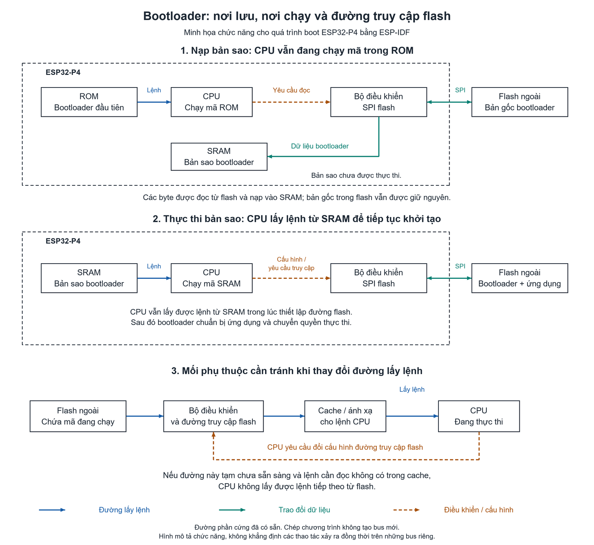

# Ghi chú thiết kế dev-kit ESP32-P4

> **Block diagram hiện hành (28/10/2026):** chỉ dùng [esp32-p4_tong-hop.drawio](block_diagram/esp32-p4_tong-hop.drawio), gồm 4 page: tổng quan, nhóm 1, nhóm 2 và nhóm 3. Nhóm 2 chốt giao tiếp riêng cho chức năng trên kit + header GPIO còn tự do. Nhóm 3 chốt Wi-Fi/Bluetooth, camera, màn hình, microSD và đo điện năng. Module, GPIO và nguồn chi tiết chưa chốt. Các phần so sánh phương án bên dưới là ghi chú quá trình học.

Tài liệu ghi lại kiến thức đã trao đổi để hiểu block diagram trước khi thiết kế schematic và PCB. Phần mở rộng IoT và Edge AI hiện có phạm vi tạm chọn ở nhóm 3: kết nối không dây, camera và màn hình.

## 1. Nguồn: phần bên ngoài và phần có sẵn trong chip

### 1.1. Đường đi của năng lượng

Bo nhận nguồn từ bên ngoài, qua các mạch bảo vệ, lọc và chuyển đổi/ổn áp cần thiết, rồi cấp vào các chân nguồn phù hợp của chip.

Ví dụ minh họa khi nhận nguồn 5 V:

```text
Nguồn vào 5 V
    |
    +--> Ổn áp nguồn chính --> 3.3 V --> các chân nguồn dùng 3.3 V
                                |
                                +--> DCDC ngoài --> khoảng 1.1 V --> miền HP
```

Đây là sơ đồ đơn giản hóa để hiểu đường cấp nguồn, chưa phải toàn bộ sơ đồ nguồn của P4. Mỗi miền nguồn phải nhận điện áp trong phạm vi datasheet quy định.

**DCDC cũng là một dạng mạch chuyển đổi/ổn áp.** Trong block diagram, tầng ổn áp nguồn chính và DCDC cho miền HP được tách riêng vì chúng có nhiệm vụ khác nhau. Tầng tạo 3.3 V có thể dùng LDO hoặc buck tùy yêu cầu; chưa chọn linh kiện cụ thể.

### 1.2. Các phần cần thiết kế bên ngoài

| Phần | Nhiệm vụ |
|---|---|
| Nguồn vào | Nhận năng lượng từ USB hoặc nguồn ngoài phù hợp |
| Bảo vệ và lọc đầu vào | Xử lý các yêu cầu bảo vệ, chất lượng nguồn của thiết kế |
| Ổn áp nguồn chính | Tạo và duy trì điện áp cấp chính, ví dụ 3.3 V từ 5 V |
| DCDC ngoài cho HP | Chuyển đổi nguồn để cấp cho miền xử lý hiệu năng cao của P4 |
| Tụ nguồn | Hỗ trợ hoạt động ổn định của bộ nguồn, giảm dao động nguồn và cung cấp dòng tức thời tại tải |

Tụ nguồn thường mắc giữa đường nguồn và GND. Có các tụ đầu vào/đầu ra của bộ ổn áp, tụ hỗ trợ tại điểm cấp nguồn và tụ decoupling đặt gần chân nguồn chip. Giá trị, loại tụ và vị trí đặt phải theo yêu cầu của từng mạch.

### 1.3. PMU: quản lý trạng thái các miền nguồn

Tên đúng là **PMU — Power Management Unit**.

- Chip được chia thành các miền nguồn, chẳng hạn HP (High Performance) và LP (Low Power).
- PMU phối hợp bật/tắt hoặc duy trì các miền theo chế độ hoạt động, ngủ và thức dậy.
- Firmware cấu hình hoặc yêu cầu chuyển chế độ; phần cứng thực hiện trình tự tương ứng.
- Chip có trạng thái và cơ chế khởi động mặc định để bắt đầu chạy trước khi firmware ứng dụng của mình hoạt động.
- Việc điều khiển theo miền nguồn và cơ chế của chip; không nên hiểu là mỗi chức năng đều có một công tắc nguồn riêng tùy ý.

PMU điều phối việc sử dụng nguồn. Năng lượng vẫn được cung cấp từ bên ngoài.

### 1.4. LDO nội bộ: các mạch ổn áp tích hợp

**LDO — Low-Dropout Regulator** là bộ ổn áp tuyến tính. Các LDO nội bộ là mạch analog thực sự được tích hợp trong chip, nhận năng lượng từ chân nguồn phù hợp và cấp điện áp cho những nhánh đã được thiết kế sẵn.

| LDO | Vai trò theo datasheet đang đọc |
|---|---|
| HP LDO | Nguồn cho miền HP theo cơ chế hoạt động của chip |
| LP LDO | Nguồn cho miền LP |
| Flash LDO | Nguồn cho flash ngoài |
| PSRAM LDO | Nguồn cho PSRAM trong package |
| VO3 và VO4 | Hai đầu ra nguồn riêng có thể cấu hình để cấp cho thiết bị phù hợp |

Một số kênh LDO cho phép cấu hình điện áp hoặc bật/tắt. VO3 và VO4 có phạm vi điện áp và giới hạn dòng riêng; không thể dùng làm nguồn tùy ý cho mọi ngoại vi.

LDO nằm trong chip nhưng đầu ra có thể đi ra một chân nguồn, rồi được nối tới tải qua PCB. Ví dụ:

```text
Nguồn ngoài --> chân cấp cho LDO --> Flash LDO trong P4
                                      |
                                      +--> VDDO_FLASH --> IC Flash ngoài
```

Không phải mọi miền của chip đều nhận nguồn qua LDO nội bộ. Có những đường cấp trực tiếp từ chân nguồn và đường cấp qua DCDC ngoài.

### 1.5. Phần phối hợp với DCDC ngoài

Bộ DCDC ngoài thực hiện chuyển đổi năng lượng, có mạch điều khiển chuyển mạch của chính nó và cần linh kiện hỗ trợ như cuộn cảm, tụ.

P4 phối hợp với bộ nguồn này qua:

- **EN_DCDC:** tín hiệu cho phép bộ DCDC ngoài hoạt động hoặc tắt.
- **FB_DCDC:** tham gia kết nối hồi tiếp để phối hợp điều chỉnh điện áp, theo đúng kiến trúc và sơ đồ tham chiếu của hãng.

Nhãn "điều khiển DCDC" trong block diagram biểu diễn phần phối hợp từ P4. IC DCDC và mạch chuyển đổi nguồn tương ứng vẫn được thiết kế bên ngoài chip.

### 1.6. Cách phân biệt các vai trò

| Thành phần | Câu hỏi nó giải quyết |
|---|---|
| PMU | Những miền nào cần duy trì nguồn trong trạng thái hiện tại? |
| LDO / DCDC | Điện áp cho từng nhánh được tạo và duy trì bằng cách nào? |
| Tụ nguồn | Làm thế nào hỗ trợ nguồn ổn định tại bộ nguồn và tại tải khi dòng thay đổi? |

## 2. Thạch anh 40 MHz và tụ tải

### 2.1. Phần có sẵn và phần bổ sung

| Phần đã có trong P4 | Phần cần bổ sung bên ngoài |
|---|---|
| Mạch dao động, PLL, bộ chọn nguồn clock, bộ chia và hệ thống phân phối clock | Thạch anh 40 MHz và các tụ tải phù hợp |

Clock cung cấp nhịp thời gian cho hoạt động của CPU, bộ nhớ và các ngoại vi.

### 2.2. Concept hoạt động đã thống nhất

Thạch anh có đặc tính cộng hưởng vật lý riêng. Khi nối thạch anh và tụ tải vào mạch dao động có sẵn trong chip, chúng tạo thành một hệ dao động. Mạch trong chip cung cấp năng lượng bù tổn hao để duy trì dao động.

Với thạch anh chính của P4, tần số danh định là **40 MHz**. Tần số thực tế còn phụ thuộc đặc tính thạch anh, tải điện dung, nhiệt độ và các điều kiện liên quan.

```text
Thạch anh ngoài + tụ tải
          ↕
Mạch dao động trong chip
          |
          v
Clock tham chiếu khoảng 40 MHz
          |
          v
Hệ thống chọn nguồn / PLL / chia clock
          |
          v
Clock cho CPU, bộ nhớ và ngoại vi
```

Firmware cấu hình các lựa chọn mà phần cứng hỗ trợ: chọn nguồn clock, cấu hình PLL, hệ số chia và bật/tắt clock cho những khối phù hợp. Chip cũng có cấu hình khởi động mặc định trước khi firmware ứng dụng cấu hình lại.

Không phải mọi clock đều bắt buộc đi qua PLL. Tùy khối, hệ thống có thể dùng trực tiếp clock tham chiếu, dùng clock qua PLL/bộ chia hoặc chọn nguồn clock khác.

**40 MHz của thạch anh không đồng nghĩa CPU chỉ chạy ở 40 MHz.** PLL và hệ thống clock bên trong tạo/chọn nhịp phù hợp cho từng khối.

### 2.3. Vai trò của tụ tải

Các tụ tải, cùng điện dung ký sinh của chân và PCB, tạo tải điện dung mà thạch anh nhìn thấy. Tải này ảnh hưởng đến tần số thực tế và khả năng khởi động dao động.

Giá trị tụ được xác định từ thông số load capacitance của thạch anh và điện dung ký sinh; chưa chọn giá trị cụ thể. Tụ tải thuộc mạch dao động, khác nhiệm vụ với tụ lọc/decoupling trên đường nguồn.

### 2.4. Phần để tìm hiểu khi vẽ schematic

Hiện đã hiểu chức năng ở mức block diagram. Các nội dung vật lý/điện sau sẽ được quay lại khi vẽ schematic:

- Cơ chế cộng hưởng và trao đổi năng lượng của thạch anh.
- Cách mạch trong chip khởi động và duy trì dao động.
- Vai trò điện của hai tụ tải, cách tính và kiểm tra giá trị.
- Yêu cầu chọn thạch anh, bố trí và đi dây trên PCB.

## 3. IC flash ngoài, bộ nhớ và quá trình boot

### 3.1. Vai trò của flash và mạch ngoài

Flash là bộ nhớ giữ nội dung khi mất nguồn, dùng để lưu firmware và dữ liệu cần lưu lâu dài. Với P4 đang xét, cần IC flash ngoài; với STM32F103C8T6, flash đã được tích hợp trong chip.

| Có sẵn trong P4 | Cần bổ sung bên ngoài |
|---|---|
| ROM chứa mã khởi động của hãng | IC flash chứa bootloader thứ hai, ứng dụng và dữ liệu |
| Bộ điều khiển truy cập flash | Các đường giao tiếp tới flash theo sơ đồ của hãng |
| Flash LDO và đầu ra VDDO_FLASH | Đường nguồn tới flash, tụ decoupling và các linh kiện hỗ trợ |

Theo sơ đồ tham chiếu, flash nhận nguồn từ VDDO_FLASH. Điện áp phải phù hợp với IC flash được chọn. Tụ decoupling đặt gần chân nguồn flash, mắc giữa nguồn và GND, giúp hỗ trợ dòng tức thời và giảm dao động nguồn tại IC.

### 3.2. Các công cụ phục vụ quá trình boot

| Thành phần | Nhiệm vụ |
|---|---|
| CPU | Lấy và thực thi các lệnh chương trình |
| ROM | Giữ bootloader đầu tiên và một số hàm có sẵn của hãng |
| Flash ngoài | Lưu bootloader thứ hai, mã ứng dụng và dữ liệu |
| SRAM nội | Giữ dữ liệu hoặc bản sao chương trình để CPU thực thi |
| Bộ điều khiển SPI flash | Thực hiện các giao dịch đọc/ghi với IC flash |
| Ánh xạ bộ nhớ và cache | Hỗ trợ CPU truy cập mã/dữ liệu lưu trên flash qua vùng địa chỉ đã được thiết lập |

Bootloader là chương trình. Không phải mỗi vùng nhớ đều bắt buộc có một bootloader riêng.

### 3.3. Các công đoạn khi boot bình thường bằng ESP-IDF

| Công đoạn | CPU lấy lệnh từ đâu? | Công việc chính |
|---|---|---|
| 1. Sau reset | ROM | Thực hiện khởi động ban đầu và xác định chế độ boot |
| 2. Nạp bootloader thứ hai | Vẫn là ROM | Đọc các byte từ flash và nạp vào SRAM |
| 3. Chạy bootloader thứ hai | Bản sao trong SRAM | Tiếp tục cấu hình flash, chọn và chuẩn bị ứng dụng |
| 4. Khởi động ứng dụng | Các vùng mã đã được chuẩn bị | Hoàn tất môi trường chạy, rồi tới app_main |

Trong bước nạp, bootloader thứ hai được coi là dữ liệu đang được vận chuyển. Sau khi nạp xong, CPU chuyển địa chỉ thực thi tới bản sao trong SRAM và bắt đầu chạy nó. Bản gốc trong flash vẫn được giữ nguyên.

### 3.4. ROM đã đọc được flash trước khi chép

ROM bootloader đã có cách đọc flash trong các cấu hình khởi động được hỗ trợ. Nếu chưa đọc được flash, nó không thể nạp bootloader thứ hai vào SRAM.

Bootloader thứ hai và ứng dụng nằm ở các vùng địa chỉ khác nhau trên cùng IC flash; không phải mỗi vùng có một giao thức đọc riêng.

ROM dùng thông tin trong header của bootloader để nạp nó. Bootloader thứ hai có thể cấu hình lại giao tiếp flash theo header của ứng dụng được chọn, chẳng hạn tần số và chế độ giao tiếp. Cấu hình ban đầu đã dùng được; cấu hình tiếp theo phục vụ yêu cầu của ứng dụng và quá trình khởi tạo.

Đọc các byte qua SPI và thiết lập để CPU lấy lệnh ứng dụng qua ánh xạ/cache là hai công việc khác nhau.

### 3.5. Vì sao chạy bản sao bootloader trong SRAM?

Đây là cách ESP-IDF tổ chức bootloader thứ hai. Về mặt kiến trúc, việc chạy trong SRAM giúp mã khởi tạo có nguồn lệnh độc lập với đường truy cập flash đang được thiết lập.

Ví dụ: một lệnh thay đổi cấu hình đường truy cập flash, còn lệnh tiếp theo vẫn được lấy từ SRAM. CPU có thể tiếp tục thực thi để hoàn tất việc cấu hình.

Nếu mã đang phụ thuộc vào flash để lấy lệnh, việc thay đổi cấu hình làm đường flash tạm chưa sẵn sàng có thể khiến CPU không lấy được lệnh tiếp theo khi lệnh đó chưa có trong cache.

Không phải mọi thay đổi cấu hình đều gây lỗi. Không nên suy ra rằng mọi bộ xử lý đều bắt buộc chép bootloader từ flash vào RAM. Việc chép cũng **không tạo thêm bus**; các đường phần cứng đã tồn tại sẵn. Điểm đang học là tránh phụ thuộc vào đường lấy lệnh đang bị thay đổi, không phải tăng tốc bằng hai bus mới.

### 3.6. Minh họa phần đã trao đổi



[Bản SVG của hình minh họa](block_diagram/esp32-p4_flash-boot-sram.svg).

Mũi tên xanh dương: đường lấy lệnh; xanh lá: trao đổi dữ liệu; cam nét đứt: điều khiển/cấu hình. Hình mô tả chức năng, không khẳng định các thao tác chạy đồng thời trên những bus độc lập.

### 3.7. Bộ nhớ trong runtime

CPU đi theo luồng chương trình; không có quy luật phải luân phiên cố định giữa ROM và flash.

- Phần lớn mã ứng dụng thường được đặt trên flash và truy cập qua ánh xạ/cache.
- Một số đoạn mã được đặt trong RAM để thực thi.
- Firmware có thể gọi hàm có sẵn trong ROM rồi trở về chương trình gọi; việc này không đồng nghĩa khởi động lại.
- RAM chứa dữ liệu đang xử lý như biến, stack, heap và bộ đệm. Thay đổi biến trong RAM không tự ghi thay đổi đó vào flash.

### 3.8. SRAM nội và PSRAM trong package

SRAM và PSRAM là hai loại RAM có đặc tính khác nhau. "Nội" và "trong package" mô tả vị trí tích hợp của bộ nhớ.

| Bộ nhớ | Đặc điểm ở mức concept | Ví dụ sử dụng |
|---|---|---|
| SRAM nội | Tích hợp trong phần xử lý; giữ dữ liệu khi được cấp nguồn mà không cần refresh định kỳ | Stack, biến điều khiển, bộ đệm và một số mã thực thi |
| PSRAM trong package | Đóng gói cùng linh kiện P4 đang xét; dùng bộ nhớ động với việc refresh được quản lý bên trong | Các vùng dữ liệu lớn như bộ đệm ảnh |

Cả hai mất dữ liệu khi mất nguồn nuôi. Việc phân bổ dữ liệu vào SRAM hay PSRAM phụ thuộc yêu cầu và cấu hình firmware; chức năng sử dụng không cố định tuyệt đối theo tên bộ nhớ.

Phần này mới được hiểu ở mức concept; cơ chế chi tiết của cache, ánh xạ, bus và công nghệ RAM sẽ được tìm hiểu khi cần.

## 4. Mạch tạo trễ reset và nút RESET

### 4.1. Phần chip có sẵn: đầu vào CHIP_PU

P4 có chân **CHIP_PU** và mạch bên trong xử lý tín hiệu cho phép chip hoạt động/reset.

| Trạng thái CHIP_PU | Ý nghĩa |
|---|---|
| Thấp | Giữ chip ở trạng thái tắt/reset; datasheet gọi trạng thái này là Power off |
| Cao | Cho phép chip thực hiện trình tự khởi động và hoạt động khi các điều kiện cần được đáp ứng |

Khi CHIP_PU thấp, CPU không thực thi ứng dụng hoặc ROM bootloader. Khi chân này được đưa lên cao đúng điều kiện, chip được cho phép khởi động và CPU bắt đầu quá trình boot từ ROM.

CHIP_PU cao không đồng nghĩa mọi miền đều đang chạy. Trong quá trình vận hành, PMU và cấu hình hệ thống còn quyết định trạng thái các miền nguồn, clock và chế độ ngủ.

### 4.2. Phần thiết kế thêm: nút RESET

- Khi bo đã được cấp nguồn, nhấn giữ nút RESET sẽ kéo CHIP_PU xuống thấp.
- Khi nhả nút, CHIP_PU tăng trở lại theo mạch ngoài, cho phép chip khởi động lại.
- Nút tác động trực tiếp bằng phần cứng, không cần firmware đọc nút và quyết định reset.
- Nhấn RESET không xóa firmware trong flash.

### 4.3. Phần thiết kế thêm: mạch tạo trễ

Nguồn điện cần thời gian để tăng lên và ổn định sau khi bắt đầu cấp nguồn. Mạch tạo trễ làm cho CHIP_PU chỉ được hiểu là mức cao sau một khoảng chờ phù hợp với thời gian ổn định nguồn.

```text
Bắt đầu cấp nguồn
        |
        v
Các đường nguồn tăng lên và ổn định
        |
        v
CHIP_PU lên mức cao sau khoảng trễ phù hợp
        |
        v
P4 thực hiện trình tự khởi động bên trong
        |
        v
CPU bắt đầu chạy ROM bootloader
```

Mạch RC (điện trở và tụ) là cách tạo trễ thường gặp. **RC tạo khoảng chờ, không trực tiếp đo và xác nhận nguồn đã ổn định.** Giá trị phải được chọn theo đặc tính lên nguồn và yêu cầu thời gian của chip; chưa chọn giá trị linh kiện ở bước học block diagram.

Mạch trễ tác động vào tín hiệu CHIP_PU. Các đường cấp nguồn có thể đã có điện trong lúc chip vẫn đang bị giữ tắt/reset.

### 4.4. Cùng điều khiển một chân

| Mạch ngoài | Mục đích |
|---|---|
| Nút RESET | Cho người dùng chủ động kéo CHIP_PU thấp rồi nhả để khởi động lại |
| Mạch tạo trễ | Tạo thời điểm đưa CHIP_PU lên cao phù hợp lúc cấp nguồn |

Cả hai phối hợp trên cùng đầu vào CHIP_PU; không cần ứng dụng đang chạy để thực hiện các chức năng này.

### 4.5. Phạm vi của kết luận khi CHIP_PU thấp

- Mạch ổn áp bên ngoài vẫn có thể tạo điện áp nếu còn được cấp nguồn và cho phép hoạt động.
- Mạch RC vẫn có thể nạp/xả tụ và tạo điện áp tại CHIP_PU.
- CPU không thực thi mã, gồm cả mã ROM bootloader; các công việc boot và giao tiếp runtime đã bàn không diễn ra.
- Flash vẫn giữ nội dung khi mất nguồn; việc IC flash còn được cấp điện hay không phụ thuộc nhánh nguồn của nó.
- Chưa xác định trạng thái điện của từng LDO, mạch PMU hoặc nhánh DCDC khi CHIP_PU thấp. Không suy ra rằng mọi mạch con đều đang hoạt động hoặc mọi phần bên trong đều hoàn toàn bị cắt nguồn.

## 5. Mạch kéo mức strapping, nút BOOT và chế độ Download

### 5.1. Strapping và mức mặc định

Một số chân của P4 có chức năng strapping: mức logic được đọc và chốt trong giai đoạn khởi động/reset phần cứng tương ứng để cung cấp thông tin cấu hình ban đầu.

- Phần chip có sẵn: đầu vào strapping, mạch đọc/chốt và logic sử dụng cấu hình đó.
- Phần mạch ngoài: bảo đảm mức mặc định thích hợp bằng pull-up/pull-down và bố trí nút BOOT để thay đổi lựa chọn khi cần.
- Firmware ứng dụng chưa chạy lúc lựa chọn chế độ boot được xử lý. ROM bootloader sử dụng các mức đã chốt để chọn nhánh khởi động.
- Chức năng và trạng thái của từng chân phải theo datasheet; không phải mọi chân strapping đều bắt buộc thêm điện trở ngoài nếu đã có cơ chế tạo mức phù hợp.

CHIP_PU cho phép chip bắt đầu khởi động. Các mức strapping cung cấp lựa chọn cho quá trình khởi động đó.

### 5.2. Hai chế độ boot cơ bản đang xét

| Chế độ | GPIO35 | GPIO36 | Ý nghĩa |
|---|---|---|---|
| SPI Boot | Cao | Bất kỳ | ROM bootloader tiếp tục khởi động chương trình đã lưu trong flash |
| Joint Download | Thấp | Cao | ROM bootloader đi vào nhánh nhận nạp, cho phép làm việc với công cụ trên máy tính |

Theo bảng 3-3 của datasheet, GPIO37/GPIO38 là bất kỳ đối với hai điều kiện cơ bản trên. Các cấu hình boot khác chưa nằm trong phạm vi đang học.

Trong chế độ Download, các đường nhận nạp được hỗ trợ gồm USB hoặc UART tương ứng. Đây là chế độ nhận lệnh nạp; không phải tự chạy ứng dụng cũ trong flash.

```text
Chip khởi động --> CPU chạy ROM bootloader --> dùng lựa chọn đã chốt
                                                   |
                               +-------------------+-------------------+
                               |                                       |
                               v                                       v
                           SPI Boot                              Joint Download
                               |                                       |
                               v                                       v
                    Khởi động ứng dụng từ flash           Chờ/giao tiếp với công cụ nạp
```

### 5.3. Nút BOOT là nút nhấn nhả

Trong phương án đang bàn, BOOT là nút nhấn nhả, không phải công tắc toggle:

- Không nhấn: pull-up giữ GPIO35 cao để mặc định chọn SPI Boot.
- Nhấn giữ: kéo GPIO35 thấp. Để chọn Joint Download còn phải bảo đảm GPIO36 cao.
- Nhả: GPIO35 trở về cao theo mạch kéo mức.

**Mức chân hiện tại và chế độ đã chốt là hai thứ khác nhau.** Chế độ được chọn trong giai đoạn khởi động/reset; nhả BOOT sau đó không lập tức đổi chế độ. Nhấn BOOT khi ứng dụng đang chạy cũng không tự chuyển sang Download.

### 5.4. Vào Download thủ công và thời gian giữ BOOT

Với GPIO36 đã được bảo đảm cao:

1. Giữ BOOT để GPIO35 thấp.
2. Nhấn rồi nhả RESET, vẫn giữ BOOT qua giai đoạn lấy mẫu strapping.
3. Có thể chờ công cụ nạp nhận dạng được chip rồi nhả BOOT.
4. Quá trình nạp tiếp tục trong chế độ Download đã được chọn.

**Không cần giữ BOOT suốt quá trình nạp.** Nút BOOT tạo mức để chọn chế độ; công cụ trên máy tính thực hiện yêu cầu nạp firmware.

### 5.5. Đường đi của dữ liệu khi nạp

P4 có phần cứng giao tiếp và chương trình nhận nạp bắt đầu từ ROM, nên vẫn có thể nạp khi flash ngoài đang trống. Công cụ như esptool có thể tải mã hỗ trợ nạp vào RAM để thực hiện những thao tác tiếp theo.

```text
Máy tính gửi từng khối lệnh/dữ liệu
                  |
                  v
Phần cứng nhận UART/USB của P4
                  |
                  v
Bộ đệm trong RAM
                  |
                  v
Bộ điều khiển SPI flash --> IC flash ngoài

CPU chạy chương trình nạp để xử lý yêu cầu và điều khiển các công đoạn trên.
```

Sơ đồ mô tả luồng chức năng, không quy định mọi chi tiết vận chuyển nội bộ. CPU không phải nơi chứa toàn bộ file firmware. Dữ liệu được tiếp nhận và xử lý theo các khối phù hợp với bộ đệm.

Phân biệt hai công việc:

- **Cấu hình bộ điều khiển:** chuẩn bị cách giao tiếp với flash.
- **Ra lệnh xóa/ghi:** dùng giao tiếp đã chuẩn bị để thay đổi nội dung flash.

Không phải nhận mỗi byte là cấu hình lại bộ điều khiển. Chương trình nạp tổ chức xóa các vùng cần thiết rồi ghi dữ liệu vào flash. Nội dung firmware được lưu lâu dài trong IC flash, không phải trong ROM hay RAM của P4.

Ngoài cách nạp qua P4, có thể dùng bộ nạp SPI chuyên dụng để nạp trực tiếp IC flash. Kit tận dụng P4 làm trung gian để dùng đường USB/UART có sẵn.

### 5.6. Khi ứng dụng đang chạy và khả năng nạp tự động

Khi chip tiếp tục chạy ứng dụng bình thường, ROM loader không ở trạng thái phục vụ các lệnh nạp. Chỉ gửi dữ liệu nạp qua UART không làm chip tự ghi firmware.

Tuy nhiên, công cụ có thể tự đưa chip sang Download trước khi truyền firmware. P4 có USB Serial/JTAG hỗ trợ tự chuyển vào chế độ này khi đường giao tiếp đó hoạt động đúng.

```text
Ứng dụng đang chạy
        |
        v
Công cụ yêu cầu chuyển sang Download
        |
        v
Chip chạy chương trình nhận nạp
        |
        v
Máy tính gửi dữ liệu để ghi flash
```

Nạp tự động giúp giảm thao tác BOOT/RESET thủ công. Đây không phải quy tắc khóa ghi flash trong SPI Boot: ứng dụng cũng có thể được viết để ghi flash hoặc tự cập nhật firmware bằng cơ chế riêng.

### 5.7. Vì sao vẫn đề xuất giữ nút BOOT trên dev-kit?

Mức strapping đúng là yêu cầu để khởi động đúng chế độ. Nút BOOT không bắt buộc cho mọi lần nạp tự động, nhưng được đề xuất giữ để vào Download thủ công khi thử nghiệm hoặc phục hồi bo.

Ví dụ, firmware đổi chức năng chân USB hoặc tắt USB Serial/JTAG có thể làm công cụ mất kết nối tự động. BOOT kết hợp RESET cung cấp đường vào Download bằng phần cứng.

### 5.8. Ở Download thì chờ gì và thoát ra thế nào?

Trong chế độ Download thông thường, chip chạy chương trình nhận nạp để chờ/giao tiếp với công cụ trên máy tính. Công cụ có thể yêu cầu đọc thông tin chip, xóa/ghi flash hoặc kết thúc quá trình nạp. Chip không tự chuyển sang ứng dụng cũ chỉ vì người dùng nhả BOOT.

Các cách trở về chạy ứng dụng thường dùng:

- Công cụ nạp yêu cầu reset sau khi nạp xong, với điều kiện lần boot tiếp theo chọn SPI Boot.
- Người dùng nhấn rồi nhả RESET khi BOOT đã được nhả và các mức strapping phù hợp.

```text
Download --> chờ/giao tiếp với công cụ nạp
                         |
                         v
              Reset với BOOT đã được nhả
                         |
                         v
                  SPI Boot --> ứng dụng
```

**Chỉ vào Download rồi chờ không tự xóa firmware cũ.** Nếu chưa có thao tác xóa/ghi, có thể reset về SPI Boot để chạy lại firmware đã lưu.

## 6. Cổng USB-C nạp/debug, mạch Type-C và bảo vệ USB

### 6.1. USB-C và USB Type-C là cùng một tên

USB-C/USB Type-C mô tả loại đầu nối và các yêu cầu kết nối tương ứng. Trên bo là ổ cắm (receptacle); trên cáp là đầu cắm (plug).

Trong phương án đang bàn, cổng này dùng USB 2.0 để nạp/debug qua khối USB Serial/JTAG của P4. Đầu nối USB-C không tự quyết định tốc độ dữ liệu hoặc các chức năng mà bo hỗ trợ.

### 6.2. Phần có sẵn trong P4

| Khối bên trong | Vai trò |
|---|---|
| USB PHY | Phát/nhận tín hiệu điện trên cặp D+/D− |
| USB Serial/JTAG Controller | Cung cấp kênh nối tiếp và JTAG qua USB |

Cùng kết nối máy tính có thể dùng để nạp firmware, đọc log và debug như đặt breakpoint, dừng/chạy từng bước, xem trạng thái chương trình bằng công cụ phù hợp.

P4 hỗ trợ trực tiếp đường USB Serial/JTAG này, nên không cần IC USB–UART riêng cho phương án đó. Khối này có chức năng cố định; các khối USB OTG ứng dụng khác chưa được xét ở đây.

### 6.3. Các nhóm chân chính và kết nối ở mức concept

| Nhóm chân | Vai trò | Kết nối trên kit đang xét |
|---|---|---|
| VBUS | Đường nguồn USB; phương án hiện tại nhận 5 V | Đưa vào khối nguồn của nhóm 1 |
| GND | Đường hồi dòng và mức tham chiếu | GND chung của bo, gồm GND P4 |
| D+/D− | Một cặp đường dữ liệu USB 2.0, dùng cho cả truyền và nhận | Đi tới đúng chân USB Serial/JTAG của P4, kèm mạch hỗ trợ và bảo vệ phù hợp |
| CC1/CC2 | Phát hiện kết nối, chiều cắm, thông tin vai trò và khả năng cấp nguồn | Mạch cấu hình Type-C phù hợp với vai trò nhận nguồn |

D+ và D− không tương ứng với TX và RX riêng như UART; chúng cùng tạo thành một cặp tín hiệu.

Với cổng nhận nguồn cơ bản đang bàn, phần khai báo vai trò có thể dùng điện trở kéo xuống riêng trên mỗi CC. **CC1 và CC2 không nối chung với nhau.** Chưa chốt giá trị linh kiện hoặc toàn bộ mạch nguồn Type-C.

```text
Cổng USB-C
    |
    +-- VBUS, GND --> khối nguồn nhóm 1 và GND chung
    |
    +-- D+/D− <--> bảo vệ/hỗ trợ tín hiệu <--> USB PHY <--> USB Serial/JTAG
    |
    +-- CC1/CC2 --> mạch cấu hình kết nối Type-C
```

Các tiếp điểm D+ lặp lại tương ứng trên ổ cắm USB 2.0 được nối chung, tương tự với D−, để hỗ trợ cắm đảo chiều. Pinout và cách nối thực tế phải đối chiếu datasheet của đầu nối được chọn.

Đầu nối Type-C đầy đủ còn có các cặp TX/RX SuperSpeed và SBU1/SBU2. Những đường này không dùng trong cổng nạp/debug USB 2.0 đang xét.

### 6.4. Vai trò của bảo vệ và phần để tìm hiểu khi vẽ schematic

Mạch bảo vệ USB, chẳng hạn bảo vệ ESD, giúp hạn chế tác động điện từ đầu nối bên ngoài tới chip. Đường VBUS cũng cần được xét trong thiết kế bảo vệ và quản lý nguồn.

Hiện đã hiểu ở mức concept: **đầu nối USB-C + mạch CC + bảo vệ/hỗ trợ tín hiệu** làm phần kết nối bên ngoài; P4 đã có phần giao tiếp USB nạp/debug bên trong.

Theo phạm vi đã thống nhất, các nội dung sau để tới bước schematic/PCB:

- Chọn đầu nối, pinout và footprint.
- Chọn điện trở CC, mạch nguồn Type-C và các linh kiện hỗ trợ.
- Nguyên lý, lựa chọn và cách mắc bảo vệ ESD/đường VBUS.
- Yêu cầu bố trí và đi dây D+/D−.

## 7. UART mức logic và header GPIO đa dụng

### 7.1. Phần trong chip và phần trên PCB

P4 đã có bộ điều khiển UART và cơ chế định tuyến tín hiệu ngoại vi tới các chân phù hợp. Firmware cấu hình bộ điều khiển và chọn chân; PCB tạo đường kết nối vật lý từ chân chip tới đầu nối.

Với UART mức logic cơ bản, cần nối TX của bên này tới RX của bên kia, RX tới TX và GND chung. Hai phía phải tương thích mức điện áp và cấu hình truyền thông. Chân cấp nguồn trên header, nếu có, là phần bổ sung của đầu nối, không phải tín hiệu UART.

Chuyển mức điện áp chỉ cần khi hai bên có mức logic khác nhau. RS-232 hoặc RS-485 cần transceiver tương ứng; không nối trực tiếp các mức điện của chúng vào GPIO. Chưa chọn các mạch này cho kit.

### 7.2. Đường dây cố định, chức năng có thể cấu hình

Ví dụ minh họa, **không phải pinout đã chọn cho kit**:

```text
GPIO A của chip ---------------- chân 3 của header
GPIO B của chip ---------------- chân 4 của header
```

Đường đồng này giữ nguyên. Nếu firmware chọn UART trên A/B, chân 3/4 mang tín hiệu UART; nếu cấu hình lại thành GPIO, chúng mang chức năng GPIO. Nếu chuyển UART sang cặp chân khác thì UART xuất hiện ở những chân vật lý mới đó.

Không phải mọi chức năng đều định tuyến tới mọi GPIO. ADC gắn với các chân có kênh ADC; còn phải xét chân khởi động, miền điện áp, chân đã dùng cho mạch trên kit và các giới hạn của datasheet.

### 7.3. Nhãn chân và tài liệu pinout

- Header đa dụng: dùng nhãn chính theo tên GPIO của chip, chẳng hạn IOx; không nhầm với số thứ tự chân package.
- Chân nguồn: ghi rõ 3V3, 5V, GND… thay vì chỉ ghi VCC khi có nhiều mức nguồn. Rail 5V trên bo không có nghĩa GPIO chịu được 5V.
- Chức năng gợi ý như UART TX/RX hoặc I²C SDA/SCL có thể ghi thêm trong tài liệu hoặc nhãn phụ, sau khi đã phân bổ chân.
- Phân biệt chân còn tự do, chân dùng chung với mạch trên kit và chân dành riêng cho một kết nối.

### 7.4. Đổi firmware không tự ngắt linh kiện ngoài

Điện trở kéo lên, tụ lọc, LED hoặc IC đã nối với GPIO vẫn nằm trên đường điện khi firmware đổi chức năng chân. Trở kéo nội có thể được điều khiển theo khả năng của chip; trở kéo bên ngoài không tự biến mất.

Ví dụ, một tụ lọc ADC có thể ảnh hưởng tín hiệu số tốc độ cao; điện trở kéo lên I²C có thể ảnh hưởng phép đo analog. Muốn tái sử dụng chân, cần đánh giá tải hiện có hoặc có cơ chế ngắt/bypass phù hợp.

Mạch kéo lên I²C hay điện trở hạn dòng LED phục vụ hoạt động của giao tiếp/tải, không chỉ là mạch bảo vệ. Bảo vệ header cần được xét riêng theo cách sử dụng; không mặc định rằng mọi module ngoài đều xử lý đầy đủ.

## 8. ADC và so sánh với Blue Pill STM32F103C8T6

### 8.1. Vì sao Blue Pill có thể đưa chân ADC ra header?

Trong schematic Blue Pill được đối chiếu, các chân PA0–PA7, PB0/PB1 có đường nối ra header mà không có bộ chia áp, khuếch đại hay lọc riêng trên từng ngõ vào. Đây là một thiết kế tham khảo cụ thể; các bo bán trên thị trường có thể khác nhau.

ADC bên trong MCU đã thực hiện lấy mẫu và chuyển điện áp thành giá trị số. Có thể nối tín hiệu trực tiếp khi điện áp, trở kháng nguồn và các điều kiện lấy mẫu đáp ứng yêu cầu của ADC. Điều này không có nghĩa mọi cảm biến hay mọi mức điện áp đều nối trực tiếp được.

| Tình huống | Phần có thể cần bổ sung |
|---|---|
| Tín hiệu đã phù hợp đầu vào ADC | Có thể nối trực tiếp, kiểm tra điều kiện đo |
| Điện áp vượt dải đo cho phép | Chia áp hoặc mạch chuyển đổi phù hợp |
| Tín hiệu nhỏ hoặc nguồn có trở kháng cao | Khuếch đại/buffer tùy yêu cầu |
| Tín hiệu nhiễu hoặc có thành phần ngoài băng cần đo | Mạch lọc phù hợp |

Tụ lọc nguồn analog/điện áp tham chiếu là một vấn đề khác với tụ lọc trên từng chân tín hiệu ADC. Dải đo ADC cũng phải kiểm tra riêng, không suy ra từ khả năng chịu điện áp khi dùng chân ở chế độ số.

### 8.2. Áp dụng cho P4

Có thể đưa những chân có ADC còn khả dụng ra header đa dụng. Tuy nhiên, không sao chép nguyên giả định về điện áp hoặc chất lượng đo của Blue Pill sang P4.

**Điểm cần giữ lại cho bước schematic:** Espressif khuyến nghị tụ xuống GND gần chân khi sử dụng ADC để cải thiện độ chính xác. Vì vậy, “header đa dụng không gắn sẵn mạch analog” là một phương án về phạm vi kit; khi thực sự dùng ADC, vẫn phải xét mạch hỗ trợ và khuyến nghị của nhà sản xuất. Chưa chốt đặt tụ trên kit, qua nhánh ngắt được, hay trên module ngoài gần đầu vào.

## 9. Bài học từ các dev-kit P4 đã tham khảo

Các schematic tham khảo cho thấy cách tổ chức thực tế thường kết hợp header GPIO với những kết nối có chức năng riêng:

- **Espressif ESP32-P4 Function EV Board v1.5.2:** có header GPIO, nhiều vị trí điện trở để cấu hình kết nối; một số chân dùng chung hoặc cần đổi linh kiện để đưa ra header.
- **Waveshare ESP32-P4-WIFI6-DB:** có header GPIO nhưng một số tín hiệu đã nối tới mạch trên bo. Có mặt trên header không đồng nghĩa chân hoàn toàn tự do.
- **Olimex ESP32-P4-DevKit Rev.D1:** có header mở rộng GPIO và đầu nối pUEXT gom các tín hiệu UART/I²C/SPI theo một quy ước sử dụng.

Đây là tham khảo kiến trúc, chưa chọn sao chép pinout hoặc mạch của bo nào. Schematic nguồn và các chi tiết liên quan chip revision phải đối chiếu đúng phiên bản trước khi triển khai.

## 10. Ba phương án nhóm 2 — chưa chốt

**Trạng thái:** giữ cả ba phương án để so sánh. Chưa chọn kiến trúc cuối, chưa phân bổ GPIO, chưa chọn số cổng, linh kiện hay cơ chế chuyển kết nối. Phạm vi mở rộng IoT/Edge AI được ghi ở mục 11.

USB nạp/debug, LED người dùng và nút USER được giữ trong cả ba hình để so sánh trên cùng phạm vi nhóm 2 trước đó. “GPIO đa dụng” áp dụng cho các chân còn khả dụng; không biến các chân nguồn, flash hay mọi kết nối riêng thành chân tự do.

### 10.1. Phương án 1: GPIO đa dụng, mạch ứng dụng ở ngoài kit

Đưa các chân phù hợp ra header, nhãn chính theo GPIO. Không tích hợp sẵn mạch riêng cho UART/I²C/SPI/ADC trên nhóm header này; module ngoài cung cấp phần hỗ trợ cần thiết theo ứng dụng. Bảo vệ header vẫn là nội dung cần xét ở schematic.

Ưu điểm là ít tải gắn sẵn và linh hoạt khi thử nhiều ứng dụng. Đổi lại, việc ghép module đòi hỏi người dùng bổ sung đúng mạch hỗ trợ.

[Xem nội dung hiện hành trong file draw.io chính](block_diagram/esp32-p4_tong-hop.drawio).

### 10.2. Phương án 2: dành chân cho giao tiếp cụ thể, phần còn lại đa dụng

Phân bổ một số chân và đầu nối cho UART, I²C, SPI; mạch hỗ trợ tương ứng được thiết kế trên kit khi cần. Những chân còn lại đưa ra header đa dụng, gồm các chân có ADC phù hợp.

“Dành chân” là quyết định của PCB và tài liệu sử dụng; firmware vẫn phải cấu hình đúng. Các mạch gắn sẵn tiếp tục ảnh hưởng GPIO nếu đổi chức năng. Không mặc định gắn transceiver hay bộ chuyển mức nếu chưa có yêu cầu.

[Xem nội dung hiện hành trong file draw.io chính](block_diagram/esp32-p4_tong-hop.drawio).

### 10.3. Phương án 3: có cơ chế bật/tắt hoặc chọn kết nối phần cứng

Giữ khả năng dùng GPIO đa dụng và bổ sung cơ chế ngắt/chọn kết nối ở những nơi hữu ích, ví dụ:

- Ngắt nhánh điện trở kéo lên I²C trong khi đường GPIO tới header vẫn liên tục.
- Ngắt hoặc chọn kết nối UART/SPI với đầu nối hay IC trên kit, nếu được trang bị.
- Chọn đường ADC trực tiếp hoặc qua mạch điều hòa tín hiệu, nếu được trang bị.
- Ngắt nhánh LED hoặc nút USER để thu hồi chân khi cần.

Có thể dùng jumper, cầu hàn, vị trí điện trở tùy chọn hoặc switch/mux phù hợp. Jumper/cầu hàn là cấu hình thủ công; không đồng nghĩa chuyển chức năng tự động bằng firmware. Nếu muốn điều khiển đường kết nối bằng firmware thì phải có phần cứng chuyển mạch phù hợp. Chưa chọn cơ chế cụ thể.

Trong hình, các ô màu xanh là những ví dụ cơ chế kết nối; không có nghĩa phải trang bị tất cả hoặc dùng cùng một loại mạch cho mọi tín hiệu. Việc chọn đường/bypass phải xét cả tải, tụ và các nhánh còn kết nối, không chỉ ngắt nguồn của một IC.

[Xem nội dung hiện hành trong file draw.io chính](block_diagram/esp32-p4_tong-hop.drawio).

### 10.4. Hai lớp cấu hình phải phân biệt

| Lớp | Quyết định điều gì? | Cách thực hiện |
|---|---|---|
| Bên trong chip | Chân mang chức năng GPIO hay tín hiệu ngoại vi nào trong phạm vi hỗ trợ | Cấu hình firmware, IO MUX/GPIO matrix và ngoại vi liên quan |
| Bên ngoài chip | Chân nối với đầu nối, tải hay mạch hỗ trợ nào | Đường đồng, jumper/cầu hàn, switch hoặc mạch chọn đường |

Ba hướng có thể kết hợp trên cùng một bo. Các hình hiện tại nhằm làm rõ lựa chọn trước khi chốt, không yêu cầu cả kit phải theo duy nhất một hướng.

Các mũi tên là đường trao đổi tín hiệu ở mức khối, có thể đại diện nhiều dây. Các hàng UART/I²C/SPI/GPIO-ADC mô tả các nhóm khả năng; không phải tất cả cùng hoạt động trên một chân hay các chân trên header bị nối chung. Khối GPIO/Timer-PWM/ADC chỉ gom chức năng để trình bày, không phải mọi tín hiệu analog đi qua GPIO matrix.

- [File draw.io chính — 4 page, nội dung hiện hành](block_diagram/esp32-p4_tong-hop.drawio).
- Bộ hình nhóm 2 cũ được giữ nguyên làm bản tham khảo trước khi tách phương án.

## 11. Nhóm 3 — Kết nối không dây, camera và màn hình

### 11.1. Phạm vi chức năng hiện tại

Tạm chốt phạm vi nhóm 3: kết nối không dây là yêu cầu bắt buộc của kit này theo định hướng IoT; có camera phục vụ ứng dụng AI hình ảnh và màn hình để hiển thị/giao tiếp tại thiết bị. Module không dây nằm trên PCB kit; camera và màn hình là module cắm ngoài, kit cung cấp phần giao tiếp và hỗ trợ. Chưa chọn model linh kiện, pinout hoặc hiệu năng mục tiêu.

| Khối | Phần bổ sung bên ngoài P4 | Phần có sẵn trong P4 |
|---|---|---|
| Kết nối không dây | Module trên PCB chính; nguồn, reset, đường nạp/cập nhật và anten theo module | Giao tiếp với module đồng hành qua SDIO/SPI/UART theo phương án chọn; P4 không tích hợp radio Wi-Fi/Bluetooth |
| Camera | Module camera cắm rời; đầu nối, nguồn và mạch hỗ trợ/điều khiển trên kit | MIPI-CSI và ISP; I²C/GPIO điều khiển theo camera |
| Màn hình | Module màn hình cắm rời; đầu nối, nguồn, đèn nền nếu cần và mạch điều khiển trên kit | MIPI-DSI; GPIO/PWM/I²C hoặc tín hiệu phụ theo màn hình |

ESP32-C6 là ứng viên tham khảo cho module không dây, chưa phải lựa chọn cuối. MIPI-CSI cho camera và MIPI-DSI cho màn hình là hướng giao tiếp đang đề xuất, cần xác nhận theo module và phần mềm hỗ trợ. Cảm ứng chưa chốt; audio, microSD và Ethernet chưa được bổ sung vào phạm vi hiện tại.

### 11.2. Luồng ứng dụng dự kiến

```text
Camera --> P4 nhận ảnh, xử lý và suy luận AI
                          |
                          +--> Màn hình: ảnh, kết quả, trạng thái
                          |
                          +--> Module không dây --> mạng / hệ thống bên ngoài
```

Chức năng Edge AI được thực hiện bằng firmware/mô hình chạy trên hệ thống xử lý và bộ nhớ của P4. Camera cung cấp dữ liệu đầu vào, không tự tạo thành chức năng AI. Chưa đặt yêu cầu tốc độ suy luận, độ phân giải hoặc truyền video.

### 11.3. Liên hệ với nhóm 1 và nhóm 2

- Nhóm 1 phải đáp ứng các rail, công suất và trình tự cấp nguồn của module không dây, camera và màn hình sau khi chọn chúng.
- Những chân dành cho nhóm 3 phải được tính trước khi xác định GPIO còn tự do trên các header nhóm 2.
- Camera và màn hình cắm rời giúp thay module, nhưng đầu nối/cáp phải đúng pinout, điện áp và yêu cầu của module cụ thể.
- Các đường điều khiển và cấp nguồn trong block diagram mới chỉ là liên kết chức năng; chưa phải schematic.

[Xem nội dung hiện hành trong file draw.io chính](block_diagram/esp32-p4_tong-hop.drawio).

- [File draw.io chính — 4 page, nội dung hiện hành](block_diagram/esp32-p4_tong-hop.drawio).

### 11.4. Kết nối không dây — cách P4 và module phối hợp

P4 chạy ứng dụng chính; module đồng hành cung cấp phần kết nối Wi-Fi/Bluetooth theo phương án phần mềm được chọn. P4 trao đổi lệnh, dữ liệu và trạng thái với module qua đường giao tiếp có dây. Firmware hai phía phải tương thích; cách phân chia chi tiết giao thức mạng phụ thuộc giải pháp sử dụng.

```text
P4: firmware ứng dụng
        |
        v
Giao tiếp SDIO / SPI / UART được chọn
        |
        v
Module: firmware giao tiếp + phần cứng không dây
        |
        v
Anten <--> router Wi-Fi hoặc thiết bị không dây tương ứng
```

SDIO/SPI/UART trong block diagram là các phương án đang cân nhắc, không mặc định phải nối cả ba. Chỉ kết nối đường điện chưa đủ: module phải có firmware phù hợp với chức năng đồng hành mà P4 sử dụng.

**Ví dụ module Bluetooth có giao tiếp UART:**

```text
ESP32-P4                  Module Bluetooth

UART TX ----------------> RX
UART RX <---------------- TX
GND --------------------- GND
                           ^
                      Nguồn phù hợp
```

- Nối chéo TX sang RX của phía bên kia; dùng GND chung và mức điện áp logic tương thích.
- Cấu hình baud rate, số bit dữ liệu, parity và stop bit phải phù hợp hai phía.
- Module có chế độ truyền trong suốt có thể chuyển tiếp dữ liệu UART qua Bluetooth sau khi cấu hình/kết nối theo yêu cầu của nó.
- Module khác có thể yêu cầu tập lệnh hoặc định dạng dữ liệu riêng; P4 phải làm việc đúng theo giao thức mà firmware module cung cấp.
- Chiều phát: ứng dụng P4 tạo dữ liệu, gửi qua UART, module xử lý rồi phát Bluetooth. Chiều nhận diễn ra ngược lại.

Với ứng viên ESP32-C6, kit có hai bộ xử lý chạy chương trình riêng và phối hợp với nhau. Có thể dùng giải pháp đồng hành có sẵn như ESP-Hosted, thay vì tự xây dựng toàn bộ phần mềm kết nối. C6 đang là ứng viên, chưa chốt firmware, bus hoặc module cụ thể.

**Phần module đã tích hợp và phần kit cần bổ sung:** với ví dụ ESP32-C6-MINI-1, module đã có chip C6, bộ nhớ, thạch anh, phần cứng không dây và anten PCB; MINI-1U dùng đầu nối anten ngoài. Kit còn phải cấp nguồn và tụ lọc phù hợp, nối bus với P4, thiết kế điều kiện enable/reset/khởi động và đường nạp/cập nhật, đồng thời bố trí vùng anten theo hướng dẫn module. Chi tiết điện và linh kiện để tới bước schematic/PCB.

### 11.5. Camera — module tạo ảnh, P4 nhận và xử lý

Module camera thường gồm ống kính, cảm biến ảnh và các mạch hỗ trợ tùy module. Cảm biến chuyển ánh sáng thành dữ liệu ảnh số. Trong hướng đang xét, camera xuất ảnh qua MIPI-CSI tới P4.

MIPI-CSI là giao tiếp camera nối tiếp, dùng để truyền dữ liệu ảnh/video từ cảm biến tới bộ xử lý. CSI viết tắt của Camera Serial Interface; MIPI CSI-2 là chuẩn liên quan đang được nhắc tới trong phần giải thích. Việc P4 có MIPI-CSI nghĩa là chip đã tích hợp phần cứng nhận giao tiếp camera này; camera và P4 phải tương thích về khả năng và cấu hình.

| Nhóm kết nối | Nhiệm vụ |
|---|---|
| Nguồn và GND | Cấp nguồn đúng yêu cầu camera/module |
| I²C hoặc giao tiếp điều khiển của cảm biến | Đọc/ghi các thanh ghi: cấu hình định dạng, độ phân giải, thời gian phơi sáng… |
| MIPI-CSI | Đưa luồng dữ liệu ảnh từ camera tới P4 |
| Reset/enable và clock nếu cần | Khởi động và vận hành theo yêu cầu module |

**Vì sao tách điều khiển và dữ liệu ảnh?** Lệnh cấu hình thường có lượng dữ liệu nhỏ; luồng ảnh liên tục cần băng thông lớn. Ví dụ minh họa ảnh chưa nén 640 × 480 pixel, 2 byte/pixel, 30 khung/giây cần khoảng 18,4 MB/giây chỉ riêng dữ liệu pixel. I²C cung cấp đường truy cập cấu hình trước khi camera phát ảnh và trong lúc ảnh đang truyền qua MIPI-CSI.

Đây là cách phân nhiệm của kiến trúc đang xét, không phải quy luật buộc mọi hệ camera dùng hai giao tiếp riêng. Không dùng I²C làm đường mang luồng pixel trong phương án hiện tại.

```text
P4 -- đường điều khiển --> camera: chọn cấu hình, cho phép xuất ảnh

Ánh sáng --> ống kính --> cảm biến camera
                              |
                              v
                          MIPI-CSI
                              |
                              v
                 P4: bộ nhận --> ISP --> DMA --> RAM
                                                   |
                                                   v
                                   Chương trình xử lý / suy luận AI
```

P4 có ISP (Image Signal Processor) để thực hiện các bước xử lý ảnh như xử lý màu, khử nhiễu và chuyển đổi dữ liệu theo cấu hình. ISP và bộ điều khiển camera phối hợp với DMA đưa dữ liệu tới bộ nhớ. Firmware cấu hình camera, khối nhận/ISP và bộ đệm, sau đó sử dụng dữ liệu ảnh; không cần CPU tự đọc từng pixel bằng thao tác GPIO.

**Phạm vi PCB kit:** thiết kế đầu nối, nguồn, đường MIPI-CSI, đường điều khiển và các linh kiện hỗ trợ/lọc/bảo vệ theo module được chọn. Module ngoài cung cấp phần thu ảnh. Điện áp, clock, giá trị linh kiện, pinout và cách đi dây để sang schematic/PCB.

### 11.6. Màn hình — P4 xuất ảnh, module ngoài hiển thị

Màn hình cũng là module cắm rời; kit thiết kế phần giao tiếp và hỗ trợ cho module đó. Hướng đang đề xuất là truyền dữ liệu hiển thị từ P4 qua MIPI-DSI; chưa chốt model màn hình hoặc chuẩn kết nối cuối.

Trên PCB kit cần có đầu nối đúng pinout, nguồn/GND phù hợp, đường dữ liệu hiển thị, các đường reset/enable hoặc điều khiển phụ theo module, cùng linh kiện hỗ trợ và bảo vệ cần thiết. Bổ sung nguồn và điều khiển đèn nền nếu loại màn hình được chọn yêu cầu.

```text
Camera   -- ảnh --> P4
Màn hình <-- ảnh -- P4
```

Firmware khởi tạo module màn hình, cấu hình khối xuất hình trong P4 và cung cấp dữ liệu/bộ đệm để hiển thị. Nếu chọn màn hình có cảm ứng, phải xét thêm phần cảm ứng và giao tiếp tương ứng; cảm ứng hiện chưa chốt.

## 12. Page tổng hợp và trạng thái tạm chốt

Page đầu của file draw.io chính hiện là bản trình bày gọn theo tỉ lệ 16:9: P4 ở trung tâm, các khối bên ngoài đặt xung quanh; nhóm 1 bên trái, nhóm 2 bên phải và nhóm 3 phía dưới. Chữ và phần mô tả chức năng được rút gọn để trình bày; các page chi tiết giữ nguyên nội dung đầy đủ.

Theo yêu cầu của người thiết kế, **page trình bày tạm dùng phương án 1 của nhóm 2: header GPIO đa dụng, mạch ứng dụng ở module ngoài**. Đây là lựa chọn để trình bày cho gọn, chưa phải chốt bỏ các phương án còn lại. Page chi tiết nhóm 2 vẫn có đủ cả ba phương án để so sánh.

| Page | Nội dung |
|---|---|
| 1 | Tổng quan gọn: P4 ở giữa; nhóm 2 tạm dùng phương án 1 |
| 2 | Nhóm 1 — phần cốt lõi |
| 3 | Nhóm 2 — cả ba phương án trên cùng page |
| 4 | Nhóm 3 — không dây, camera và màn hình |

Các page chi tiết trước đó được giữ nguyên nội dung và chỉ lùi thứ tự. Tạm chốt kiến trúc sử dụng module camera/màn hình ngoài và phần giao tiếp trên kit; chưa chốt linh kiện, pinout, camera/màn hình cụ thể, cảm ứng hoặc một trong ba phương án nhóm 2. MIPI-CSI/DSI và ứng viên module C6 giữ nguyên trạng thái đề xuất trên hình.

- [File draw.io chính — 4 page, nội dung hiện hành](block_diagram/esp32-p4_tong-hop.drawio).
- [Hình tổng quan trình bày 16:9](block_diagram/esp32-p4_tong-hop.png).
- [Bản SVG tổng hợp](block_diagram/esp32-p4_tong-hop.svg).
- [File draw.io chính — 4 page, nội dung hiện hành](block_diagram/esp32-p4_tong-hop.drawio).

## Tài liệu đối chiếu

- [Datasheet trong thư mục](esp32-p4-chip-revision-v1.3_datasheet_en.pdf): mục 2.6, bảng 2-12 và hình 2-2 (trang 28–29); mục 4.1.4.6 (trang 46–47); điều kiện điện áp hoạt động (trang 79).
- [Espressif Hardware Design Guidelines — Power Supply](https://docs.espressif.com/projects/esp-hardware-design-guidelines/en/latest/esp32p4/schematic-checklist-esp32p4.html#power-supply).
- [Espressif Hardware Design Guidelines — Internal Voltage Regulators and External DCDC](https://docs.espressif.com/projects/esp-hardware-design-guidelines/en/latest/esp32p4/schematic-checklist-esp32p4.html#internal-voltage-regulators-and-external-dcdc).
- [ESP-IDF — LDO Regulator](https://docs.espressif.com/projects/esp-idf/en/stable/esp32p4/api-reference/peripherals/ldo_regulator.html).
- [Espressif Hardware Design Guidelines — Clock Source](https://docs.espressif.com/projects/esp-hardware-design-guidelines/en/latest/esp32p4/schematic-checklist-esp32p4.html#clock-source).
- [ST AN2867 — Nguyên lý và thiết kế mạch dao động thạch anh](https://www.st.com/resource/en/application_note/an2867-guidelines-for-oscillator-design-on-stm8afals-and-stm32-mcusmpus-stmicroelectronics.pdf): tham khảo nguyên lý chung; yêu cầu triển khai cho P4 đối chiếu tài liệu Espressif.
- [Espressif Hardware Design Guidelines — Flash and PSRAM](https://docs.espressif.com/projects/esp-hardware-design-guidelines/en/latest/esp32p4/schematic-checklist-esp32p4.html#flash-and-psram).
- [ESP-IDF — Application Startup Flow](https://docs.espressif.com/projects/esp-idf/en/stable/esp32p4/api-guides/startup.html).
- [ESP-IDF — SPI Flash Configuration During Boot](https://docs.espressif.com/projects/esp-idf/en/stable/esp32p4/api-guides/bootloader.html#spi-flash-configuration).
- [ESP-IDF — Memory Types](https://docs.espressif.com/projects/esp-idf/en/stable/esp32p4/api-guides/memory-types.html).
- [Espressif Hardware Design Guidelines — Chip Power-up and Reset Timing](https://docs.espressif.com/projects/esp-hardware-design-guidelines/en/latest/esp32p4/schematic-checklist-esp32p4.html#chip-power-up-and-reset-timing); datasheet mục 2.6.3 (trang 29–30) và bảng 5-8 (trang 82).
- [Espressif Hardware Design Guidelines — Strapping Pins](https://docs.espressif.com/projects/esp-hardware-design-guidelines/en/latest/esp32p4/schematic-checklist-esp32p4.html#strapping-pins); datasheet chương 3, đặc biệt bảng 3-3 (trang 32–33).
- [Esptool — Serial Protocol](https://docs.espressif.com/projects/esptool/en/latest/esp32p4/advanced-topics/serial-protocol.html) và [Flasher Stub](https://docs.espressif.com/projects/esptool/en/latest/esp32p4/esptool/flasher-stub.html).
- [ESP-IDF — USB Serial/JTAG Console](https://docs.espressif.com/projects/esp-idf/en/stable/esp32p4/api-guides/usb-serial-jtag-console.html): nạp tự động và trường hợp cần vào Download thủ công.
- [Espressif Hardware Design Guidelines — USB](https://docs.espressif.com/projects/esp-hardware-design-guidelines/en/latest/esp32p4/schematic-checklist-esp32p4.html#usb).
- [TI — An Engineer's Guide to USB Type-C](https://www.ti.com/lit/eb/slyy228/slyy228.pdf): các nhóm chân và vai trò Type-C.
- [TI — How to Easily Move from USB 2.0 to USB Type-C](https://www.ti.com/document-viewer/lit/html/SSZTC87/GUID-E5AE2236-6116-4C43-8618-4F4AF8947651): đầu nối, các tiếp điểm dữ liệu lặp lại và chân CC.
- [Infineon — SRAM](https://www.infineon.com/products/memories/sram-static-ram) và [PSRAM](https://www.infineon.com/products/memories/psram-pseudostatic-dram): tham khảo nguyên lý chung của các loại RAM.
- [Block diagram nhóm 1](block_diagram/esp32-p4_tong-hop.drawio).
- [ESP-IDF — GPIO & RTC GPIO](https://docs.espressif.com/projects/esp-idf/en/stable/esp32p4/api-reference/peripherals/gpio.html): bảng khả năng/giới hạn chân, GPIO matrix và IO MUX.
- [Espressif Hardware Design Guidelines — GPIO](https://docs.espressif.com/projects/esp-hardware-design-guidelines/en/latest/esp32p4/schematic-checklist-esp32p4.html#gpio) và [ADC](https://docs.espressif.com/projects/esp-hardware-design-guidelines/en/latest/esp32p4/schematic-checklist-esp32p4.html#adc): kiểm tra giới hạn định tuyến và khuyến nghị hỗ trợ đầu vào ADC.
- [ESP-IDF — UART](https://docs.espressif.com/projects/esp-idf/en/stable/esp32p4/api-reference/peripherals/uart.html) và [I²C](https://docs.espressif.com/projects/esp-idf/en/stable/esp32p4/api-reference/peripherals/i2c.html).
- [Schematic Blue Pill gốc, VCC-GND Studio, 26/01/2016; bản lưu trên STM32-base](https://stm32-base.org/assets/pdf/boards/original-schematic-STM32F103C8T6-Blue_Pill.pdf) và [ST — STM32F103C8 datasheet](https://www.st.com/resource/en/datasheet/stm32f103c8.pdf).
- [Espressif — Function EV Board schematic v1.5.2](https://dl.espressif.com/dl/schematics/esp32-p4-function-ev-board-schematics_v1.52.pdf).
- [Waveshare — ESP32-P4-WIFI6-DB schematic](https://github.com/waveshareteam/ESP32-P4-WIFI6-DB/blob/main/hardware/ESP32-P4-WIFI6-DB.pdf).
- [Olimex — ESP32-P4-DevKit Rev.D1 schematic](https://github.com/OLIMEX/ESP32-P4-DevKit/blob/main/HARDWARE/ESP32-P4-DevKit-Rev.D1/ESP32-P4-DevKit_Rev_D1.pdf).
- [Espressif — ESP32-P4](https://www.espressif.com/en/products/socs/esp32-p4): khả năng xử lý, MIPI-CSI/ISP, MIPI-DSI và module kết nối đồng hành.
- [Espressif — ESP32-P4X-Function-EV-Board](https://docs.espressif.com/projects/esp-dev-kits/en/latest/esp32p4/esp32-p4x-function-ev-board/user_guide.html): tham khảo tổ hợp P4 + module C6 + đầu nối camera và màn hình.
- [Espressif — ESP-Hosted](https://github.com/espressif/esp-hosted-mcu): bộ xử lý chính, chip đồng hành và đường truyền giữa hai phía.
- [Espressif — ESP32-C6-MINI-1 / MINI-1U datasheet](https://www.espressif.com/sites/default/files/documentation/esp32-c6-mini-1_mini-1u_datasheet_en.pdf): thành phần tích hợp, nguồn và tùy chọn anten của module ví dụ.
- [MIPI Alliance — CSI-2](https://www.mipi.org/specifications/csi-2): giao tiếp truyền ảnh/video từ cảm biến tới bộ xử lý.
- [ESP-IDF — Camera Controller Driver](https://docs.espressif.com/projects/esp-idf/en/stable/esp32p4/api-reference/peripherals/camera_driver.html): các khối camera và cách nhận dữ liệu trên P4.
- [ESP-IDF — Image Signal Processor](https://docs.espressif.com/projects/esp-idf/en/stable/esp32p4/api-reference/peripherals/isp.html): xử lý ảnh và đường dữ liệu qua DMA tới bộ nhớ.
