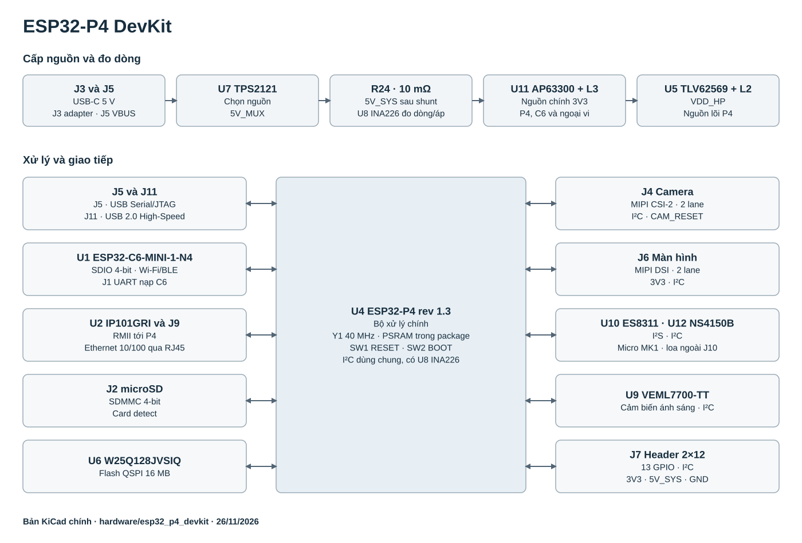
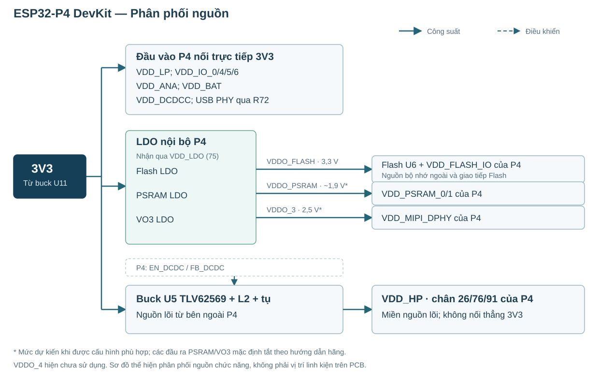

# ESP32-P4 DevKit

**Hardware Design Reference**

Phần cứng devkit ESP32-P4 cho ứng dụng IoT và Edge AI

**PRELIMINARY · Revision 0.5 · 26/11/2026**

---

## Tổng quan

ESP32-P4 DevKit dùng **U4 ESP32-P4 rev 1.3** làm bộ xử lý chính và **U1 ESP32-C6-MINI-1-N4** cho Wi-Fi và Bluetooth LE. Board tích hợp Ethernet 10/100, microSD, audio và cảm biến ánh sáng. Camera và màn hình cắm qua hai cổng MIPI riêng.

Ba cổng USB-C có vai trò riêng. **J3** nhận nguồn 5 V. **J5** nạp/debug P4 và đưa nguồn vào bộ chọn. **J11** truyền dữ liệu USB 2.0 High-Speed.

Bản KiCad chính nằm tại `hardware/esp32_p4_devkit/`. Revision 0.5 cập nhật kiến trúc, giao tiếp, nguồn và tình trạng bố trí theo bản này. Các mức điện áp và dòng nêu trong tài liệu là giá trị thiết kế. Chưa có kết quả chế tạo hoặc đo kiểm để xác nhận.

## Nội dung

1. [Kiến trúc hệ thống](#1-kiến-trúc-hệ-thống)
2. [Thông số thiết kế](#2-thông-số-thiết-kế)
3. [Đầu nối và tín hiệu](#3-đầu-nối-và-tín-hiệu)
4. [Mô tả chức năng phần cứng](#4-mô-tả-chức-năng-phần-cứng)
5. [Cơ sở thiết kế và lựa chọn linh kiện](#5-cơ-sở-thiết-kế-và-lựa-chọn-linh-kiện)
6. [Yêu cầu bố trí PCB](#6-yêu-cầu-bố-trí-pcb)
7. [Chế tạo và lắp ráp](#7-chế-tạo-và-lắp-ráp)
8. [Kiểm tra và đánh giá](#8-kiểm-tra-và-đánh-giá)
9. [Hướng dẫn sử dụng](#9-hướng-dẫn-sử-dụng)
10. [Tài liệu và file thiết kế](#10-tài-liệu-và-file-thiết-kế)
11. [Lịch sử sửa đổi](#11-lịch-sử-sửa-đổi)

Khung tài liệu bao quát toàn bộ vòng phát triển dev-kit. Các mục chưa triển khai được giữ tại vị trí tương ứng với trạng thái ngắn; yêu cầu mở và đầu việc chi tiết được quản lý trong [Design Tracker](ESP32-P4_Design_Tracker.md).

## 1. Kiến trúc hệ thống

### 1.1. Sơ đồ khối

*Hình 1-1. Kiến trúc phần cứng theo bản KiCad chính.*

[Bản Draw.io](block_diagram/esp32-p4_tong-hop.drawio) mở ở trang **Bản hiện hành**. [Design Block trong KiCad](hardware/esp32_p4_devkit/Design_Block.kicad_sch) nằm cùng schematic phân cấp.

### 1.2. Cấu trúc nguồn

**J3 và J5 → U7 TPS2121 → 5V_MUX → R24 → 5V_SYS → U11 AP63300 → 3V3.** U7 ưu tiên adapter theo cấu hình PR1/CP2. R24 là shunt 10 mΩ. U8 INA226 đo sụt áp hai đầu shunt và điện áp bus phía tải.

| Rail | Nguồn tạo | Tải chính |
|---|---|---|
| `5V_SYS` | Đầu ra bộ chọn U7 qua R24 | Buck U11, ampli U12 và chân 5 V trên J7 |
| `3V3` | Buck U11 AP63300 và L3 | Các miền 3,3 V của P4, C6 và các khối ngoại vi |
| `VDD_HP` | Buck U5 TLV62569 và L2 | Ba chân nguồn lõi U4 |
| `VDDO_FLASH`, `VDDO_PSRAM`, `VDDO_3` | LDO trong P4 | Flash, PSRAM và MIPI PHY theo từng rail |

VBUS của J11 đi tới mạch nhận biết VBUS. Việc chọn nguồn hệ thống diễn ra qua hai đầu vào J3 và J5.

*Hình 1-2. Phân phối 3V3 và các miền nguồn P4.*

### 1.3. Tổ chức sơ đồ nguyên lý

| Sheet trong KiCad | Nội dung |
|---|---|
| Root và Design_Block | Liên kết các sheet và tổng quan kiến trúc |
| Power_USB | Ba cổng USB-C, bảo vệ, chọn nguồn, đo dòng/áp và buck 3V3 |
| ESP32_P4 | P4, nguồn lõi, bộ nhớ, clock, RESET/BOOT |
| Connectivity | ESP32-C6, UART nạp C6 và Ethernet |
| Multimedia | Camera, màn hình, audio và microSD |
| User_IO | Header GPIO và cảm biến ánh sáng |

## 2. Thông số thiết kế

### 2.1. Cấu hình nền tảng

**Bảng 2-1. Cấu hình phần cứng hiện tại**

| Hạng mục | Cấu hình |
|---|---|
| Bộ xử lý | ESP32-P4, thiết kế theo revision 1.3 |
| Mã P4 theo BOM | ESP32-P4NRW32. Xác nhận revision 1.3 với nhà cung cấp. |
| Clock ngoài | Thạch anh thụ động 40 MHz |
| Flash ngoài | W25Q128JVSIQ, Quad SPI |
| Dung lượng Flash dự kiến | 128 Mbit, tương đương 16 MB |
| Giao diện nạp/debug | USB Serial/JTAG |
| Nguồn chính | 3,3 V từ buck AP63300 |
| Nguồn lõi | Buck TLV62569 phối hợp với P4 |

Mã trên symbol mô tả cấu hình schematic. Mã đặt mua đầy đủ, tình trạng sản phẩm và footprint phải được xác nhận trong BOM trước khi phát hành thiết kế.

### 2.2. Điều kiện vận hành dự kiến

**Bảng 2-2. Các thông số hệ thống cần đặc tả**

| Thông số | Min | Danh định | Max | Đơn vị | Điều kiện |
|---|---:|---:|---:|---|---|
| Nguồn adapter tại J3 | — | 5 | — | V | Adapter ổn áp, khả năng cấp ít nhất 3 A; dung sai cần đặc tả |
| Nguồn vào USB | — | 5 | — | V | Theo khả năng nguồn USB được sử dụng |
| Nguồn chính 3V3 | — | 3,3 | — | V | Sai số hệ thống và biến động tải chưa chốt |
| Dòng tải liên tục từ nguồn ngoài | — | — | — | A | Chờ ngân sách tải và đánh giá nhiệt |
| Dòng tải khi chỉ cấp USB | — | — | — | A | Chờ xác định điều kiện cấp nguồn USB |
| Nhiệt độ hoạt động của board | — | — | — | °C | Chờ phạm vi sử dụng và BOM |

Các giới hạn vận hành trên board chưa được xác nhận. Dòng định mức của một IC hoặc ngưỡng bảo vệ không được sử dụng thay cho định mức của toàn hệ thống.

### 2.3. Cấu hình điều khiển nguồn

| Chức năng | Cấu hình hiện tại | Ý nghĩa |
|---|---|---|
| Ưu tiên adapter | R31/R32 = 100 kΩ/100 kΩ; PR1 nhận nửa điện áp adapter, CP2 nối GND | Tại adapter 5 V, PR1 khoảng 2,5 V; ưu tiên VIN1 theo chế độ IC |
| Giám sát quá áp tùy chỉnh | OV1/OV2 nối GND | Không thiết lập ngưỡng OVLO bên ngoài |
| Giới hạn dòng chung TPS2121 | R33 = 29,8 kΩ | Khoảng 3/3,5/4 A min/typ/max theo bảng datasheet, chưa cộng sai số điện trở |
| Soft-start | C46 = 100 nF | Với đầu ra 5 V, thời gian tăng áp khoảng 6,4 ms điển hình, không gồm các độ trễ khác |

Giới hạn dòng IC không phải dòng được phép lấy từ nguồn USB. Khi cả hai nguồn hợp lệ, việc chọn nguồn tuân theo logic PR1/CP2 của TPS2121; không xem cầu chia này như một ngưỡng bảo vệ thấp áp độc lập. Xem REF-07.

### 2.4. Ngân sách nguồn

Ngân sách nguồn sẽ được xác lập theo từng chế độ hoạt động của P4 và các module được chọn. Phải xét dòng liên tục, dòng đỉnh, hiệu suất chuyển đổi và tải trực tiếp trên đường 5 V.

Tạm chọn adapter 5 V có khả năng cấp 3 A và buck 3V3 có mục tiêu khả năng cấp 3 A ở đầu ra. Đây là hai giới hạn tại hai điện áp khác nhau, không phải dòng tiêu thụ xác nhận. Tải 3V3 phải quy về công suất đầu vào qua hiệu suất buck rồi cộng tải 5 V trực tiếp. Không cộng khả năng cấp dòng của hai cổng USB. Kết quả tải định lượng chưa được phát hành trong revision này. Bảng tải và giả định được theo dõi tại [Design Tracker](ESP32-P4_Design_Tracker.md).

## 3. Đầu nối và tín hiệu

### 3.1. J3 - USB-C nhận nguồn adapter

J3 dùng symbol USB_C_Receptacle_USB2.0_16P. VBUS tạo VBUS_ADAPTER_5V; GND và shield nối GND chung. CC1/CC2 có R27/R28 = 5,1 kΩ riêng xuống GND. D+/D− và SBU không sử dụng. C48 = 1 µF và D2 (BOM chọn SMAJ6.0A, footprint SMA) mắc từ VBUS xuống GND hỗ trợ xử lý xung cắm/rút. Đây không phải tầng bảo vệ nguồn sai điện áp kéo dài. Mã đầu nối, cáp và khả năng chịu dòng thực tế cần chốt trong BOM.

### 3.2. J5 - USB-C nạp/debug

**Bảng 3-1. Các nhóm tiếp điểm USB-C**

| Nhóm tiếp điểm | Kết nối trong thiết kế |
|---|---|
| VBUS | VBUS_USB_5V tới VIN2 của U7 |
| GND | GND chung |
| CC1, CC2 | Mỗi chân qua một điện trở 5,1 kΩ riêng xuống GND |
| D−: A7/B7 | USB_JTAG_CONN_N |
| D+: A6/B6 | USB_JTAG_CONN_P |
| SBU1, SBU2 | Không sử dụng |
| Shield | GND trong phương án hiện tại |

**Bảng 3-2. Ánh xạ USB Serial/JTAG tới P4**

| Tín hiệu | Đường nối | Chân P4 |
|---|---|---|
| USB D− | USB_DM_CONN → R10 | GPIO24, chân 52 |
| USB D+ | USB_DP_CONN → R11 | GPIO25, chân 53 |

U3 là mạch bảo vệ ESD mắc nhánh trên cặp dữ liệu. R10/R11 hiện được dùng như điện trở nối tiếp 0 Ω. Khả năng cấp dòng của nguồn USB phải được đánh giá riêng; hai điện trở CC không tự thiết lập một giới hạn dòng chủ động trên board.

J5 dùng kiểu đầu nối Type-C với cặp dữ liệu USB 2.0. Hai tiếp điểm D+ nối cùng net và hai tiếp điểm D− nối cùng net để hỗ trợ đảo chiều đầu cắm; D+/D− là cặp tín hiệu hai chiều. CC1/CC2 có các điện trở Rd riêng để biểu thị phía nhận nguồn. Thiết kế hiện tại chưa có bộ điều khiển USB Power Delivery hoặc mạch phát hiện mức dòng Type-C được quảng bá.

U3 TPD2E2U06DCK chuyển hướng dòng xung ESD qua mạng bảo vệ để hạn chế điện áp trên đường dữ liệu. U3 không xử lý giao thức USB và không thay thế bảo vệ nguồn VBUS. Bộ USB Serial/JTAG tích hợp trong P4 đảm nhiệm chức năng nạp, console và debug tương ứng; không dùng IC USB–UART rời trên đường này. Xem REF-08 đến REF-10.

### 3.3. J11 - USB-C High-Speed

J11 dùng hai đường dữ liệu USB High-Speed về P4 qua R111/R112. U13 bảo vệ ESD. R113/R114 nhận biết VBUS qua một GPIO.

### 3.4. Điều khiển khởi động

**Bảng 3-3. Các tín hiệu RESET và BOOT**

| Tín hiệu | Chân P4 | Chức năng |
|---|---|---|
| CHIP_PU | 103 | Cho phép hoạt động/reset chip |
| GPIO35 | 66 | Chọn chế độ boot, điều khiển bằng SW2 |
| GPIO36 | 68 | Kéo lên trong cấu hình download đang chọn |

J7 đưa ra 13 GPIO, I²C, 3V3, 5V_SYS và GND. Các cổng chuyên dụng được mô tả ở mục 4.8 đến 4.14.

## 4. Mô tả chức năng phần cứng

### 4.1. Nhận nguồn và xử lý xung cắm/rút

Phạm vi đã chốt: kit nhận nguồn adapter ổn áp 5 V, có khả năng cấp ít nhất 3 A. Nguồn không hợp lệ nằm ngoài phạm vi bảo đảm hoạt động. Thiết kế nguồn hiện dùng TVS và TPS2121. Q1 trong bản hiện hành thuộc mạch reset camera.

J3 có C48 = 1 µF và D2. J5 có C49 = 1 µF và D3. BOM chọn SMAJ6.0A cho D2/D3/D5 theo footprint SMA. Schematic còn dùng tên SMF6V0A. Các TVS mắc cathode về VBUS, anode về GND. TVS không kẹp cứng ở điện áp ghi trong tên; phải xét điện áp đánh thủng, điện áp kẹp tại dòng xung, nguồn xung và điện áp chịu đựng của tải. Chưa có kiểm thử hot-plug trên phần cứng.

*Hình 4-1. Sheet Power_USB, xuất từ schematic đã lưu ngày 29/10/2026.*

### 4.2. Chọn nguồn hệ thống

U7 TPS2121 nhận VBUS_ADAPTER_5V ở VIN1 chân 7, VBUS_USB_5V ở VIN2 chân 2. OUT chân 1 và 8 cùng nối 5V_MUX. C50 = 10 µF lọc 5V_MUX. Sau R24, C53 = 10 µF lọc 5V_SYS. R31/R32 = 100 kΩ/100 kΩ chia áp adapter cho PR1; CP2, OV1 và OV2 nối GND. Adapter 5 V được ưu tiên; khi adapter không còn hợp lệ, IC có thể dùng nguồn USB nạp. Không bảo đảm tải toàn kit chạy ổn định hoặc không reset khi chuyển sang một cổng nạp thiếu công suất.

R33 = 29,8 kΩ đặt giới hạn dòng chung, C46 = 100 nF đặt soft-start. ST chân 9 nối GND khi không dùng theo REF-07, bảng chức năng chân trang 4. Ngoại lệ ERC giữa ST và PWR_FLAG của GND được lưu kèm chú thích; không đổi kiểu chân ST để làm mất cảnh báo.

U7 tự chọn nguồn bằng phần cứng; P4 chưa nhận thông tin CC để quản lý ngân sách nguồn. Mạch không ghép dòng hai đầu vào. Xem REF-07.

### 4.3. Nguồn 3,3 V

U11 AP63300WU là buck điều chỉnh điện áp bằng cầu chia hồi tiếp. VIN và EN nhận 5V_SYS. SW chân 5 đi qua L3 tới 3V3. C6 = 100 nF nối BST chân 6 với SW. FB chân 1 nhận điện áp tại điểm giữa R25 và R2.

| Reference | Giá trị | Chức năng |
|---|---|---|
| U11 | AP63300WU | Buck đồng bộ, mục tiêu đầu ra 3 A |
| L3 | 4,7 µH | Cuộn cảm đầu ra |
| C53 | 10 µF | Tụ đầu vào |
| C6 | 100 nF | Bootstrap BST–SW |
| C3/C4 | 22 µF mỗi tụ | Tụ đầu ra |
| R25/R2 | 93,1 kΩ / 30,1 kΩ | Chia áp từ 3V3 tới FB rồi GND |
| C5 | 56 pF | Song song R25 |

Với tham chiếu điển hình 0,8 V, VOUT = 0,8 × (1 + 93,1/30,1) ≈ 3,274 V, thuộc cấu hình 3,3 V tham khảo REF-05. Vòng điều khiển thay đổi đóng cắt để giữ điện áp đầu ra. Cuộn cảm và tụ ảnh hưởng gợn, đáp ứng tải và ổn định; không thay thế cầu chia đặt điện áp. Mã cuộn cảm, dòng bão hòa, dòng chịu nhiệt, điện dung hiệu dụng và khả năng tản nhiệt PCB chưa được xác nhận. Dòng 3 A là mục tiêu khả năng cấp, chưa phải kết quả đo board.

### 4.4. Nguồn lõi ESP32-P4

U5 TLV62569DBV nhận nguồn 3V3. SW đi qua L2 tới VDD_HP, cấp cho ba chân P4 số 26, 76 và 91. P4 điều khiển EN qua EN_DCDC và nối tới FB của U5 qua FB_DCDC.

**Bảng 4-4. Cấu hình nguồn lõi**

| Reference/nhóm | Giá trị | Chức năng |
|---|---|---|
| L2 | 2,2 µH | Cuộn cảm đầu ra |
| C35 | 4,7 µF | Tụ đầu vào |
| C36 | 22 µF | Tụ đầu ra |
| R5/R6 | 499 kΩ mỗi điện trở | DNP trong BOM hiện hành |
| C37 | 22 pF | DNP trong BOM hiện hành |
| C38–C41 | 100 nF mỗi tụ | Decoupling trên cùng rail VDD_HP |

TLV62569 có đầu ra điều chỉnh được. Trong kiến trúc này, nguồn công suất đi từ 3V3 qua U5/L2 tới VDD_HP; EN_DCDC/FB_DCDC là các tín hiệu phối hợp với P4. Không coi hai chân điều khiển đó là đầu ra công suất hoặc coi U5 như bộ ổn áp cố định độc lập với chip. Datasheet P4 quy định miền VDD_HP có dải khuyến nghị 0,99–1,3 V và được điều chỉnh theo tình trạng hoạt động. Xem REF-01, REF-02 và REF-06.

**Bảng 4-5. Các đầu vào P4 nối trực tiếp 3V3 trong schematic**

| Nhóm chân | Chân số | Vai trò |
|---|---|---|
| VDD_LP | 9 | Nhóm nguồn/I/O LP |
| VDD_IO_0/4/5/6 | 21, 62, 85, 96 | Các nhóm I/O HP |
| VDD_ANA | 101 | Nguồn analog |
| VDD_BAT | 102 | Nguồn analog/backup; hiện không dùng pin riêng |
| VDD_LDO | 75 | Nguồn vào các LDO nội bộ |
| VDD_DCDCC | 77 | Nguồn khối điều khiển DC–DC |
| VDD_USBPHY | 51 | Nguồn PHY USB High-Speed, nhận 3V3 qua R72 (0 Ω) |

**Bảng 4-6. Đầu ra LDO và các miền được cấp**

| Đầu ra P4 | Mức điện áp/cấu hình | Kết nối hiện tại |
|---|---|---|
| VDDO_FLASH, chân 71 | Mặc định 3,3 V theo cấu hình chip thông thường | VCC U6 chân 8 và VDD_FLASH_IO P4 chân 30 |
| VDDO_PSRAM, chân 72 | Khoảng 1,9 V theo hướng dẫn; cần cấu hình phần mềm | VDD_PSRAM_0/1, chân 59/67 |
| VDDO_3, chân 73 | Dự kiến cấu hình 2,5 V | VDD_MIPI_DPHY, chân 41 |
| VDDO_4, chân 74 | Chưa sử dụng | Không nối trong phương án hiện tại |

VDDO_PSRAM và VDDO_3 mặc định tắt theo hướng dẫn hãng; nối dây chưa đủ tạo mức điện áp mong muốn. Các đầu ra LDO đi ra package rồi nối tới chân nguồn của miền sử dụng, kèm tụ ngoài. Cấu hình firmware và trình tự nguồn phải được xác nhận khi bring-up. Các đầu vào VDD_HP, PSRAM và MIPI không nối trực tiếp 3V3.

### 4.5. RESET và BOOT

CHIP_PU được kéo lên 3V3 qua R7 = 10 kΩ; C42 = 1 µF nối xuống GND. SW1 kéo CHIP_PU xuống thấp khi nhấn.

GPIO35 được kéo lên qua R8. SW2 kéo chân này xuống GND qua R75 khi nhấn. GPIO35 dùng chung với ETH_TXD1. GPIO36 được kéo lên qua R9. R8/R9 đều 10 kΩ.

**Bảng 4-7. Chế độ boot theo cấu hình đã chọn**

| Chế độ | GPIO35 | GPIO36 |
|---|---|---|
| SPI boot | HIGH | Không quyết định chế độ này |
| Joint download | LOW | HIGH |

Thao tác download bằng tay: giữ BOOT, nhấn rồi nhả RESET, tiếp tục giữ BOOT qua khoảng đọc strapping rồi nhả. Các yêu cầu timing phải theo REF-01.

### 4.6. Thạch anh 40 MHz

Y1 nối giữa XTAL_P và XTAL_N qua R12/R13 0 Ω; hai pad vỏ nối GND. C43/C44 hiện là 16 pF và nằm ở phía thạch anh của các điện trở nối tiếp.

Giá trị tụ tải là lựa chọn ban đầu với CL = 10 pF và điện dung ký sinh tổng giả định 2 pF. Mã thạch anh, dung sai, ESR và drive level cần được rà theo BOM; chưa có phép đo xác nhận tần số.

### 4.7. Flash ngoài

U6 W25Q128JVSIQ là Flash ngoài để lưu firmware và dữ liệu không mất khi tắt nguồn; dung lượng dự kiến 128 Mbit = 16 MB. U6 sử dụng nguồn VDDO_FLASH và tụ cục bộ C45 = 100 nF. Cùng rail này cấp VDD_FLASH_IO phía P4. Sáu đường Flash của P4 nối tới U6 qua R14–R19 0 Ω. R20 = 10 kΩ kéo CS# lên VDDO_FLASH ở phía Flash.

**Bảng 4-8. Kết nối Quad SPI**

| P4 | Chân P4 | Điện trở | Flash U6 | Chân U6 |
|---|---:|---|---|---:|
| FLASH_CS | 27 | R14 | CS# | 1 |
| FLASH_CK | 32 | R15 | CLK | 6 |
| FLASH_D | 33 | R16 | DI/IO0 | 5 |
| FLASH_Q | 28 | R17 | DO/IO1 | 2 |
| FLASH_WP | 29 | R18 | WP#/IO2 | 3 |
| FLASH_HOLD | 31 | R19 | HOLD#/RESET#/IO3 | 7 |

### 4.7.1. Đối chiếu Flash, BOOT và RESET với board tham khảo

Đối chiếu ngày 29/10/2026 sử dụng trang 3 của Function EV 1.8 và Function EV C5 2.0 (REF-13/14), trang 2 của EYE 2.4 (REF-15), cùng netlist schematic hiện tại. Đây là kiểm tra cấu trúc và kết nối; chưa có xác nhận hoạt động trên phần cứng.

| Hạng mục | Dev-kit hiện tại | Function EV 1.8 / C5 2.0 | EYE 2.4 |
|---|---|---|---|
| Flash | W25Q128JVSIQ, dự kiến 16 MB/3,3 V | Symbol FLASH-3V3, không ghi mã IC cụ thể | GD25Q128ESIG, 16 MB/3,3 V |
| Nguồn Flash | VDDO_FLASH; cùng rail cấp VDD_FLASH_IO | Cùng kiến trúc | Cùng kiến trúc |
| Kéo lên CS# | R20 = 10 kΩ về nguồn Flash | 10 kΩ | 10 kΩ |
| Tụ sát Flash | C45 = 100 nF | 100 nF | 100 nF |
| BOOT | R8 = 10 kΩ kéo GPIO35 lên, SW2 kéo xuống GND | Cùng nguyên lý | Cùng nguyên lý |
| GPIO36 | R9 = 10 kΩ kéo lên | 10 kΩ kéo lên | 10 kΩ kéo lên |
| Tụ tại BOOT | Không bố trí | 100 nF, đánh dấu NC: không lắp | 100 nF, đánh dấu NC: không lắp |
| RESET | R7 = 10 kΩ kéo CHIP_PU lên 3V3; C42 = 1 µF; SW1 kéo xuống GND | 10 kΩ/1 µF; kéo lên ESP_VBAT | 10 kΩ/1 µF; kéo lên ESP_3V3 |

R14–R19 bằng 0 Ω chừa vị trí ngắt đường Flash khi kiểm tra hoặc tinh chỉnh điện trở nối tiếp khi cần. Không xem việc thêm điện trở là bằng chứng tín hiệu tốt hơn; phải xét PCB và kết quả đo. Chọn Flash khác hãng cần đối chiếu đúng mã đặt mua, điện áp, package, tốc độ và hỗ trợ phần mềm.

GPIO35 HIGH chọn SPI boot. GPIO35 LOW và GPIO36 HIGH chọn Joint Download Boot theo REF-01. Các tụ BOOT đánh dấu NC trong board hãng là vị trí tùy chọn, không phải linh kiện bắt buộc đang được lắp.

Hai Function EV kéo RESET lên ESP_VBAT; thiết kế hiện tại kéo lên 3V3 và cũng cấp VDD_BAT bằng 3V3 nên nhất quán. Nếu tách nguồn VDD_BAT sau này, cần xem lại nhánh RESET. Chưa phát hiện khác biệt trong ba khối này đòi hỏi sửa ngay; test point và header nạp bổ sung có thể chọn theo nhu cầu kiểm tra.

### 4.8. GPIO và các giao tiếp ngoại vi

**J7** là header 2×12 với 13 GPIO, I²C, 3V3, 5V_SYS và GND. Hai nút người dùng SW5/SW6 đưa tín hiệu về P4. Bus I²C dùng chung cho INA226, codec, cảm biến ánh sáng và các cổng J4/J6/J7.

### 4.9. Kết nối không dây

**U1 ESP32-C6-MINI-1-N4** kết nối P4 qua SDIO 4-bit và tín hiệu C6_EN. J1 đưa ra UART nạp/debug C6. SW3 và SW4 là RESET và BOOT riêng của C6.

### 4.10. Camera

**J4** là đầu FFC 15 chân, bước 1 mm. Dữ liệu ảnh vào P4 qua MIPI CSI-2 với hai lane dữ liệu và một cặp clock. P4 cấu hình cảm biến qua I²C và điều khiển CAM_RESET qua Q1.

### 4.11. Màn hình

**J6** là đầu FFC 15 chân, bước 1 mm. P4 xuất hình qua MIPI DSI với hai lane dữ liệu và một cặp clock. Đầu nối có 3V3 và bus I²C.

### 4.12. microSD và đo dòng/áp

Khe **J2 DM3AT-SF-PEJM5** dùng SDMMC 4-bit và tín hiệu SD_DET. **U8 INA226** đọc dòng qua shunt **R24 10 mΩ** và áp trên 5V_SYS. P4 đọc kết quả qua I²C. Việc tính năng lượng theo thời gian thuộc phần firmware.

### 4.13. Ethernet và USB High-Speed

P4 nối **U2 IP101GRI** bằng RMII và MDC/MDIO. **Y2** cấp dao động 25 MHz cho PHY, U2 tạo clock RMII 50 MHz. Hai cặp MDI nối U2 với **J9 HR913550A**, cổng RJ45 có biến áp tích hợp.

**J11** nối USB 2.0 High-Speed của P4 qua R111/R112 và mạch ESD U13. Cầu chia R113/R114 đưa tín hiệu nhận biết VBUS về P4.

### 4.14. Audio và cảm biến ánh sáng

Micro electret **MK1** đưa tín hiệu analog vào codec **U10 ES8311**. Codec trao đổi mẫu âm thanh qua I²S và được cấu hình qua I²C. Tín hiệu phát đi qua ampli **U12 NS4150B** đến đầu nối loa **J10**. **U9 VEML7700-TT** đo ánh sáng môi trường qua I²C.

## 5. Cơ sở thiết kế và lựa chọn linh kiện

### 5.1. Phương pháp xác lập thông số

Thông số linh kiện được lựa chọn từ yêu cầu hệ thống, giới hạn datasheet và mạch tham khảo, sau đó kiểm tra theo điều kiện điện/nhiệt thực tế. Phần tính toán chi tiết sẽ phân biệt giá trị điển hình, giới hạn bảo đảm và giả định.

Với các ngưỡng chia áp, phải xét sai số điện trở, sai số ngưỡng IC và dòng rò chân. Với đường công suất, phải xét sụt áp, tổn hao và điều kiện chuyển nguồn. Các kết quả danh định ở Bảng 2-3 chưa thay thế phân tích biên.

### 5.2. Tụ nguồn và mạng phân phối nguồn

Tụ cục bộ hỗ trợ dòng quá độ và giảm trở kháng mạng cấp nguồn trong dải tần liên quan. Việc chọn tụ phải xét điện dung hiệu dụng dưới điện áp DC, sai số/nhiệt độ, ESR/ESL và đường nối.

Tụ đầu vào/đầu ra bộ ổn áp còn chịu các yêu cầu về đáp ứng và ổn định vòng điều khiển. Các tổ hợp tụ khác giá trị cần được đánh giá theo trở kháng tổng, bao gồm khả năng phản cộng hưởng.

Trong thiết kế hiện tại, nhiều giá trị xuất phát từ mạch tham khảo hãng. Mã tụ cụ thể và đặc tính tải chưa đủ để xác nhận mạng decoupling đã được tối ưu.

### 5.3. BOM

[BOM ở thư mục gốc](BOM.xlsx) đã đối chiếu với KiCad bản chính. Danh sách gồm 237 linh kiện dự kiến lắp và 5 vị trí DNP. Cần xác nhận nguồn mua MK1 và revision silicon U4 trước khi đặt. Các lựa chọn mua khác mã schematic được ghi rõ ở từng dòng.

### 5.4. Tính toán danh định cấu hình nguồn

Cầu chia R31/R32 cùng bằng 100 kΩ cho V_PR1 = V_ADAPTER/2, tức khoảng 2,5 V khi adapter 5 V. Giá trị này được đánh giá cùng logic CP2 nối GND trong REF-07; không diễn giải như ngưỡng ngắt thấp áp độc lập của toàn kit.

Cầu chia hồi tiếp R25/R2 của AP63300 cho VOUT ≈ 0,8 × (1 + 93,1/30,1) = 3,274 V. Các giá trị điển hình không thay thế phân tích sai số và thử tải thực tế. Các phép tính UVLO/OVLO của eFuse và PR1 của TPS2116 trong revision trước không còn áp dụng cho schematic hiện tại.

### 5.5. Lựa chọn mạng LC của U11

Trong mô hình buck lý tưởng dòng liên tục, `V_L = L × di/dt` và `VOUT ≈ D × VIN`. Điểm 5 V → 3,3 V tương ứng D ≈ 66%; mô hình này không mô tả mọi trạng thái tải nhẹ/PFM.

Với cùng điện áp trên L, tăng điện cảm làm dòng biến đổi chậm hơn và giảm độ gợn; giảm điện cảm làm dòng biến đổi nhanh hơn và có thể tăng dòng đỉnh. L3 = 4,7 µH, tụ đầu vào 10 µF, tụ đầu ra 2 × 22 µF và bootstrap 100 nF xuất phát từ cấu hình khuyến nghị AP63300 trong REF-05. Chốt mã linh kiện phải xét dòng bão hòa, dòng chịu nhiệt, DCR, điện dung hiệu dụng và tương thích vòng điều khiển.

## 6. Yêu cầu bố trí PCB

PCB bản chính sử dụng bốn lớp. Xem [quy tắc layout 4 lớp](docs/pcb/quy-tac-layout-4-lop-2026-11-08.md) để tra các quyết định bố trí.

### 6.1. Đường công suất và GND

Độ sụt áp, dòng chịu tải, nhiệt và đường hồi dòng phải được kiểm tra cùng stack-up và hình học đường đồng.

### 6.2. Bộ nguồn và tụ cục bộ

Vòng dòng đóng cắt, tụ đầu vào, tụ đầu ra và các nút hồi tiếp cần được bố trí theo hướng dẫn của bộ chuyển đổi. Tụ tại chân IC phải có đường nối ngắn phù hợp; khoảng cách trên schematic không biểu thị khoảng cách vật lý.

### 6.3. Clock và giao tiếp

Các cặp USB, MIPI và Ethernet có quy tắc riêng trong project KiCad. Tuyến Ethernet RMII dùng clock 50 MHz giữa U2 và P4. Hai cặp MDI chạy giữa U2 và J9.

### 6.4. Cơ khí, stack-up và review layout

Board có kích thước 100 × 70 mm, dày danh định 1,6 mm. F.Cu và B.Cu dùng cho linh kiện và tín hiệu. In1.Cu có vùng GND chính. In2.Cu có các vùng 3V3 và 5V_SYS. Báo cáo DRC dùng để phát hành cần chạy lại trên đúng bản PCB chính.

## 7. Chế tạo và lắp ráp

### 7.1. Bộ hồ sơ phát hành

**Trạng thái: chưa phát hành.** Hồ sơ sẽ gồm revision board, Gerber/drill, yêu cầu chế tạo PCB, BOM, bản vẽ lắp ráp và pick-and-place nếu dùng dịch vụ lắp ráp. Các file xuất phải thuộc cùng một bản thiết kế đã được review.

### 7.2. Kiểm tra sau lắp ráp

**Trạng thái: chưa có board.** Tiêu chí kiểm tra ngoại quan, cực tính, lỗi hàn và kiểm tra điện trước cấp nguồn sẽ được xác lập theo BOM/layout hoàn thiện.

## 8. Kiểm tra và đánh giá

### 8.1. Review schematic

Các phiên review ngày 27/10/2026 đã sử dụng netlist/ERC để kiểm tra các kết nối nguồn, RESET/BOOT, clock, Flash và USB đã triển khai. Kết quả này áp dụng cho những bản lưu tương ứng; không phải thông số kiểm chứng trên board thật.

Các lần chỉnh bố cục ngày 28/10/2026 được đối chiếu với bản trước chỉnh: 89 mục linh kiện và 119 net trong netlist không đổi; ERC vẫn 75 mục với các nhóm vấn đề tương đương. Đây là xác nhận phạm vi thay đổi trình bày, không phải kết luận schematic đã sạch ERC hoặc mạch đã hoạt động. [Báo cáo đối chiếu](docs/verification/schematic-layout-2026-10-28.json).

Thông tin từng mốc review, file bằng chứng và vấn đề còn lại được quản lý trong [Design Tracker](ESP32-P4_Design_Tracker.md).

Kiểm tra ngày 29/10/2026 sau thiết kế lại nguồn: ERC còn 68 mục chân chưa nối và 5 cảnh báo nhiều tên trên cùng net. Các mục này được giữ để tiếp tục review theo phạm vi thiết kế; không xem là kết luận toàn bộ lỗi đều vô hại. Ngoại lệ ST–GND của TPS2121 được lưu kèm lý do theo datasheet. Chân nguồn VDD_ANA/VDD_BAT của symbol U4 đã sửa thành Power input. Đường 3V3 từ Power_USB sang P4 đã được kiểm tra bằng netlist.

### 8.2. Đánh giá điện và nhiệt

Chưa có kết quả đo điện áp, dòng, đáp ứng bảo vệ, đáp ứng tải hoặc nhiệt. Cần xác lập tiêu chí chấp nhận và điều kiện thử trước khi kết luận khả năng hoạt động của board.

### 8.3. Nạp và chạy chương trình

Đường USB tới P4 và kết nối Flash đã được kiểm tra về connectivity. Chưa có board để xác nhận nhận thiết bị USB, nạp Flash, chạy firmware hoặc debug.

### 8.4. Các chức năng mở rộng

**Trạng thái: chưa thử nghiệm.** Kế hoạch thử từng giao tiếp được theo dõi trong Design Tracker. Kết quả đo sẽ được ghi khi có board.

## 9. Hướng dẫn sử dụng

### 9.1. Cấp nguồn và giới hạn tải

**Trạng thái: chưa phát hành hướng dẫn cho board thật.** Nguồn ngoài được thiết kế theo mức danh định 5 V. Ba cổng USB-C và phạm vi nguồn được mô tả tại mục 3. Dải cho phép, dòng tải và điều kiện dùng đồng thời hai nguồn phải được chốt qua đặc tả và kiểm thử.

### 9.2. Nạp, reset và debug

Kết nối USB Serial/JTAG và thao tác BOOT/RESET được mô tả tại mục 3.2 và 4.5. Phiên bản công cụ/SDK, lệnh nạp, cấu hình Flash/PSRAM/LDO và ví dụ firmware sẽ được bổ sung khi có kết quả bring-up tái lập.

### 9.3. Sử dụng các đầu nối mở rộng

Mục 4 nêu các giao tiếp và đầu nối đã thiết kế. Đối chiếu pinout, mặt tiếp xúc FFC và tải nguồn của module trước khi cắm.

## 10. Tài liệu và file thiết kế

### 10.1. File thiết kế

**Bảng 10-1. Hồ sơ nguồn**

| Tài liệu/file | Nội dung |
|---|---|
| [Project KiCad](hardware/esp32_p4_devkit/esp32_p4_devkit.kicad_pro) | Project schematic/PCB |
| [Schematic Root](hardware/esp32_p4_devkit/esp32_p4_devkit.kicad_sch) | Sơ đồ phân cấp |
| [Sheet Power](hardware/esp32_p4_devkit/Power.kicad_sch) | Mạch nguồn |
| [Sheet ESP32_P4](hardware/esp32_p4_devkit/ESP32_P4.kicad_sch) | Bộ xử lý và các mạch liên quan |
| [Bản vẽ Power dạng SVG](docs/assets/schematics/esp32_p4_devkit-Power_USB.svg) | Bản xuất từ schematic đã lưu, ngày 29/10/2026 |
| [Bản vẽ P4 dạng SVG](docs/assets/schematics/esp32_p4_devkit-ESP32_P4.svg) | Các miền nguồn, nguồn lõi và bộ nhớ |
| [Block diagram](block_diagram/esp32-p4_tong-hop.drawio) | Kiến trúc bản KiCad chính, trang Bản hiện hành |
| [BOM](BOM.xlsx) | Danh sách lắp, DNP và nguồn mua đã ghi nhận |
| [Design Tracker](ESP32-P4_Design_Tracker.md) | Yêu cầu, điểm chưa chốt và công việc biên soạn |

Các PDF và ảnh schematic đã xuất từ revision trước là bản lưu theo thời điểm. Dùng schematic KiCad và bản Markdown này để tra nội dung hiện hành.

### 10.2. Tài liệu tham khảo

**Bảng 10-2. Tài liệu kỹ thuật**

| ID | Tài liệu | Phạm vi áp dụng |
|---|---|---|
| REF-01 | [ESP32-P4 rev 1.3 Datasheet](https://documentation.espressif.com/esp32-p4-chip-revision-v1.3_datasheet_en.html) | Pinout, nguồn, strapping và bộ nhớ |
| REF-02 | [ESP32-P4 Hardware Design Guidelines](https://docs.espressif.com/projects/esp-hardware-design-guidelines/en/latest/esp32p4/schematic-checklist-esp32p4.html) | Hướng dẫn họ ESP32-P4. Đối chiếu REF-01 cho silicon rev 1.3. |
| REF-03 | [AO3401A](https://www.aosmd.com/pdfs/datasheet/AO3401A.pdf) | Phương án nguồn cũ, đã loại bỏ |
| REF-04 | [TPS2596](https://www.ti.com/lit/ds/symlink/tps2596.pdf) | Phương án eFuse cũ, đã loại bỏ |
| REF-05 | [AP63300](https://www.diodes.com/datasheet/download/AP63300_AP63301.pdf) | Buck 3,3 V |
| REF-06 | [TLV62569](https://www.ti.com/lit/ds/symlink/tlv62569.pdf) | Buck nguồn lõi, kết hợp REF-02 |
| REF-07 | [TPS2121](https://www.ti.com/lit/ds/symlink/tps2121.pdf) | Chọn nguồn, PR1/CP2, ILIM, SS và ST |
| REF-08 | [USB Serial/JTAG trên ESP32-P4](https://docs.espressif.com/projects/esp-idf/en/stable/esp32p4/api-guides/usb-serial-jtag-console.html) | Nạp, console và debug |
| REF-09 | [TPD2E2U06](https://www.ti.com/lit/ds/symlink/tpd2e2u06.pdf) | Bảo vệ ESD dữ liệu |
| REF-10 | [Richtek USB Type-C Power Delivery Solutions](https://www.richtek.com/Design%20Support/Technical%20Document/AN056) | CC/Rd và nhận diện phía nhận nguồn |
| REF-11 | [BZT52C8V2](https://www.diodes.com/part/view/BZT52C8V2) | Phương án bảo vệ Gate cũ, đã loại bỏ |
| REF-12 | [Winbond W25Q-JV](https://www.winbond.com/hq/product/code-storage-flash/qspi-nor/w25q-jv/?__locale=en) | Đối chiếu Flash và mã đặt mua |

| REF-13 | [Function EV 1.8](references/schematics/SCH_ESP32-P4X_FUNCTION_EV_BOARD_V1.8_20260805.pdf) | Trang 3: Flash, strapping, RESET/BOOT và đầu nối nạp |
| REF-14 | [Function EV C5 2.0](references/schematics/ESP32_P4X_C5_Function_EV_board-2.0-schematics.pdf) | Trang 3: Flash, strapping, RESET/BOOT và đầu nối nạp |
| REF-15 | [EYE 2.4](references/schematics/SCH_ESP32-P4X-EYE-MB_V2.4_20260202.pdf) | Trang 2: Flash và nút RESET/BOOT |

Datasheet đúng mã đặt mua và revision của Flash, thạch anh, tụ, cuộn cảm, ESD và đầu nối sẽ được lưu cùng BOM khi chốt linh kiện.

## 11. Lịch sử sửa đổi

**Bảng 11-1. Revision tài liệu**

| Revision | Ngày | Nội dung |
|---|---|---|
| 0.5 | 26/11/2026 | Đồng bộ nguồn, ngoại vi, sơ đồ khối, BOM và trạng thái PCB với project KiCad chính. |
| 0.4 | 29/10/2026 | Đồng bộ nguồn USB-C/TPS2121/AP63300 và phân cấp Power_USB; bổ sung đối chiếu Flash/BOOT/RESET với ba board tham khảo; ghi nhận trạng thái ERC hiện tại. |
| 0.3 | 28/10/2026 | Bổ sung nguyên lý bảo vệ/chọn nguồn/buck/USB, bảng chân và bản đồ nguồn P4/U5/U6, tính toán ngưỡng danh định; cập nhật hình schematic và giữ đầy đủ khung ngoại vi, mở rộng, PCB, chế tạo, kiểm thử, sử dụng. |
| 0.2 | 28/10/2026 | Tổ chức lại theo tài liệu tham khảo phần cứng: tổng quan, kiến trúc, thông số, giao diện, mô tả chức năng và cơ sở thiết kế. Tách theo dõi phát triển khỏi phần nội dung chính. |
| 0.1 | 28/10/2026 | Tạo khung nội dung ban đầu. |

Revision tài liệu độc lập với revision PCB và revision silicon ESP32-P4.
