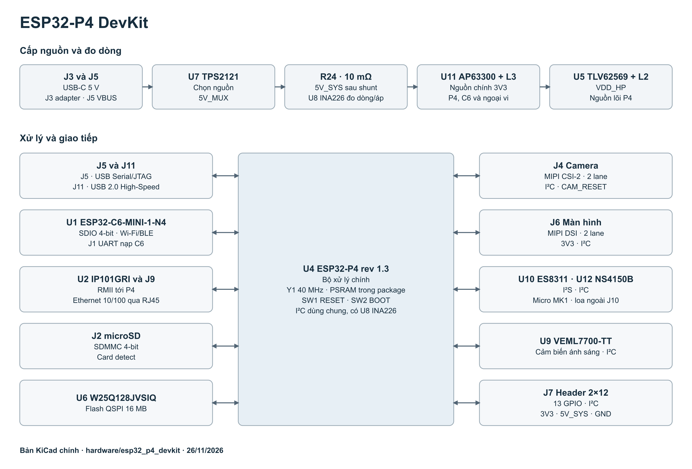

# intern-261-pcb-course

Thiết kế **ESP32-P4 DevKit** cho bài thực hành PCB. Board sử dụng **ESP32-P4 rev 1.3** làm bộ xử lý chính và **ESP32-C6** cho Wi-Fi và Bluetooth LE. PCB có **4 lớp**, kích thước **100 × 70 mm** và độ dày danh định **1,6 mm**.

## Cổng kết nối

| Cổng | Chức năng |
|---|---|
| J3 · USB-C | Nhận nguồn 5 V từ adapter |
| J5 · USB-C | Nạp và debug P4 qua USB Serial/JTAG. VBUS cũng là một đầu vào của bộ chọn nguồn. |
| J11 · USB-C | USB 2.0 High-Speed cho dữ liệu |
| J1 · Header UART | Nạp và debug ESP32-C6 |
| J4 · FFC 15 chân | Camera qua MIPI CSI-2 |
| J6 · FFC 15 chân | Màn hình qua MIPI DSI |
| J2 · microSD | Thẻ nhớ qua SDMMC 4-bit |
| J9 · RJ45 | Ethernet 10/100 qua PHY IP101GRI |
| J10 · Header loa | Loa ngoài qua ampli NS4150B |
| J7 · Header 2×12 | 13 GPIO, I²C, 3V3, 5V_SYS và GND |

Board còn có flash QSPI 16 MB, micro electret, codec ES8311, cảm biến ánh sáng VEML7700 và mạch INA226 đo dòng, áp trên nguồn hệ thống.

## Mở project KiCad

1. Dùng **KiCad 10** và cài gói **Espressif Library** qua **Plugin and Content Manager** để KiCad tra được thư viện Espressif. [Hướng dẫn cài của Espressif](https://github.com/espressif/kicad-libraries#installation-with-kicad-pcm)
2. Mở [esp32_p4_devkit.kicad_pro](hardware/esp32_p4_devkit/esp32_p4_devkit.kicad_pro) trong KiCad Project Manager. Đây là project chính để mở cả schematic và PCB.
3. Giữ nguyên cấu trúc thư mục project. `sym-lib-table` và `fp-lib-table` trỏ tới thư viện `DevKit` trong [libraries/](hardware/esp32_p4_devkit/libraries/).

## Hồ sơ thiết kế

| File | Nội dung |
|---|---|
| [BOM.xlsx](BOM.xlsx) | Danh sách linh kiện, footprint, nguồn mua và sheet DNP |
| [Sơ đồ khối Draw.io](block_diagram/esp32-p4_tong-hop.drawio) | Bản chỉnh sửa được. Xem trang **Bản hiện hành**. |
| [Tài liệu thiết kế](ESP32-P4_Hardware_Design.md) | Kiến trúc, đường nguồn, giao tiếp và bố trí PCB |
| [Design Tracker](ESP32-P4_Design_Tracker.md) | Các mục cần xác nhận trước khi đặt linh kiện, gia công và thử board |

## Trạng thái

Schematic, layout và BOM đã có trong bộ thiết kế. Cần rà ERC/DRC trên bản KiCad chính và xuất Gerber cùng file khoan từ revision chốt để gia công. Chưa có kết quả thử trên board thực.
